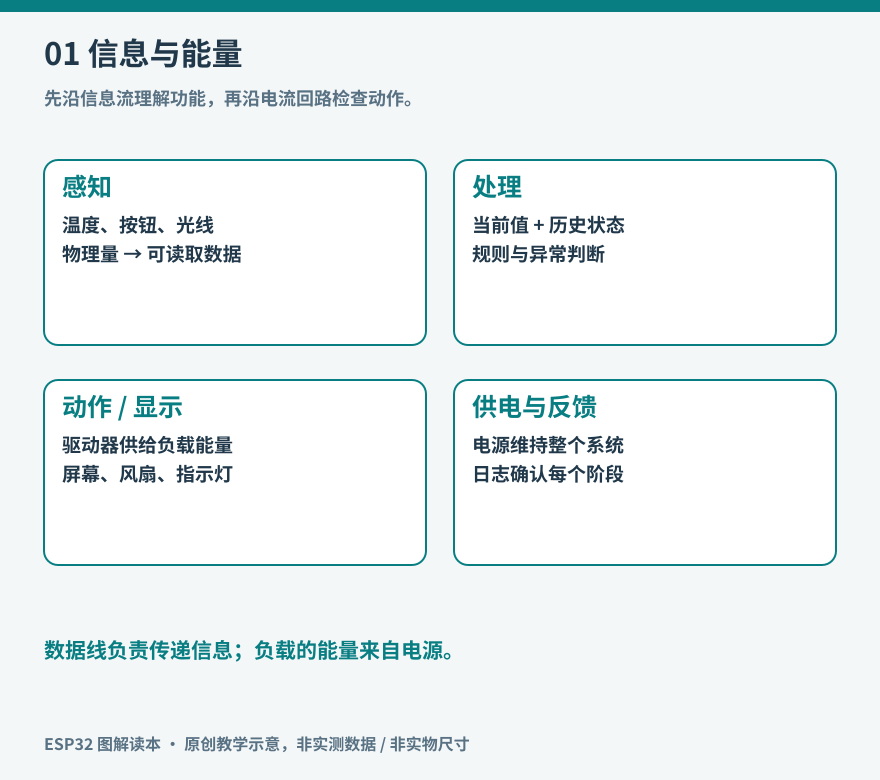

# 01 从一块板看嵌入式世界

家里的温湿度计、自动浇水器和联网插座，外观与用途相差很大，内部却有相似的结构：获取外界信息，按规则处理，再产生显示、动作或网络消息。嵌入式系统就是把计算能力放进特定设备，让程序成为设备功能的一部分。理解它，不必先把计算机专业课程学完；先看清电流、信号、数据和动作怎样连接，许多术语便有了落点。

ESP32 是乐鑫的一组微控制器产品系列。微控制器简称 MCU，通常把处理器、存储资源和外设控制功能集成到芯片里。它可以运行程序、读取引脚、控制定时器，并在部分型号上使用内置无线电。不同系列的处理器架构和无线能力不同，后文出现“ESP32”时必须辨认它指产品家族还是最早那一款芯片。[系列比较：乐鑫官方](https://docs.espressif.com/projects/esp-idf/en/latest/esp32/hw-reference/chip-series-comparison.html)。

*图 01：原创系统示意。图中分开呈现感知、处理、动作与供电，不表示实际接线。*

## 从房间温度走到风扇动作

温度本身不是程序里的数字。传感器把物理变化转成电信号，芯片内部或外部的转换电路再把它变成可读取的数据。程序根据温度、过去的状态和用户设置决定是否启动风扇；驱动电路从电源取得能量，使电机转动。最后，显示屏或日志告诉人发生了什么。

这条链有五个位置可以出错。传感器放在发热芯片旁边，测到的就未必是室温；总线接线错误，程序可能根本拿不到数据；判断规则不当，风扇可能反复启停；驱动能力不足，命令正确但电机不动；没有反馈，人只能猜设备是否还活着。学习单片机的收获，正是能把一个笼统的“不工作”拆成可以验证的问题。

输入、处理、输出之外，还有一直存在的供电系统。程序里一个高电平通常只是控制信号，不承担驱动大负载的职责。把数据流和能量流分开观察，是本书最重要的方法之一。

## 小计算机怎样安排工作

桌面电脑通常有操作系统、文件管理器和大量应用。常见 ESP32 项目则把一个固件写入闪存，设备启动后就执行它。固件是面向设备的软件集合，可能包括引导程序、应用和资源。它通常没有可供用户自由安装软件的桌面环境，但同样需要处理内存、调度、网络和更新。

芯片的内部 RAM 用于运行时数据，断电后一般不保留；Flash 用于存放程序及非易失数据；有些模组还带 PSRAM，提供额外工作内存。容量大不等于任何位置访问速度都相同，某个软件库也未必能随意使用全部内存。显示图像、缓存网络数据和运行模型时，这些差异会变得具体。

本书用三个问题检查每个功能：信息从哪里来，程序何时处理，结果通过什么方式被确认。比如按钮并非“按下就执行”，程序必须及时读取它；网络发送函数返回，也不必然代表服务器已保存记录。为这些边界设计确认和超时，是嵌入式开发的重要部分。

## 为什么用 ESP32 作为入口

ESP32 的优势在于常见开发板把处理、外设连接和无线通信放在较小的系统里，能够沿同一条学习线从点灯走向联网设备。Arduino 提供较容易起步的接口；ESP-IDF 提供更接近平台本身的配置、驱动和系统能力。[开发框架入口](https://www.espressif.com/en/products/sdks/esp-idf)。这不是要求读者一开始就选定终身工具，而是让同一个问题可以逐步深入。

它也有清晰边界。普通 MCU 项目不适合直接承接完整桌面软件、任意 Python 依赖、大型数据库或服务器级模型。需要这些能力时，可以让 MCU 负责采样和控制，让 Linux 主机承担存储、复杂计算和界面。系统拆分得当，反而能更好发挥每种设备的能力。

## 怎样阅读与动手

前六章建立共同语言，七到十四章展开外设与连接，十五到二十章解决长期运行问题，最后四章把知识组合起来。读者可以先读图和解释，再决定是否购买材料。项目材料从少量低压器件开始；昂贵设备不是理解这些原理的前提。

主实验平台约定为 ESP32-S3-DevKitC-1，代码面向 Arduino-ESP32 3.x；文中不假定所有第三方“S3 开发板”都与它接线相同。每次接线先核对自己的板卡原理图。所有程序尚未进行实板烧录验证，书中会区分完整示例、局部片段和伪代码，读者应按对应验收步骤逐级确认。

读完本章，可任选一个家中设备，画出输入、处理、输出、电源和反馈。若某部分看不见，就记下未知，而不是用“里面有 AI”替代解释。一个可检验的系统模型，往往从承认哪些信息尚不清楚开始。
