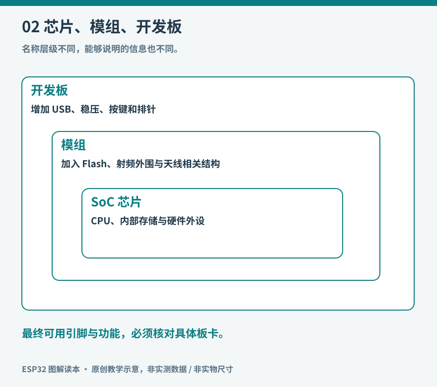
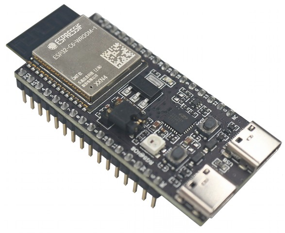
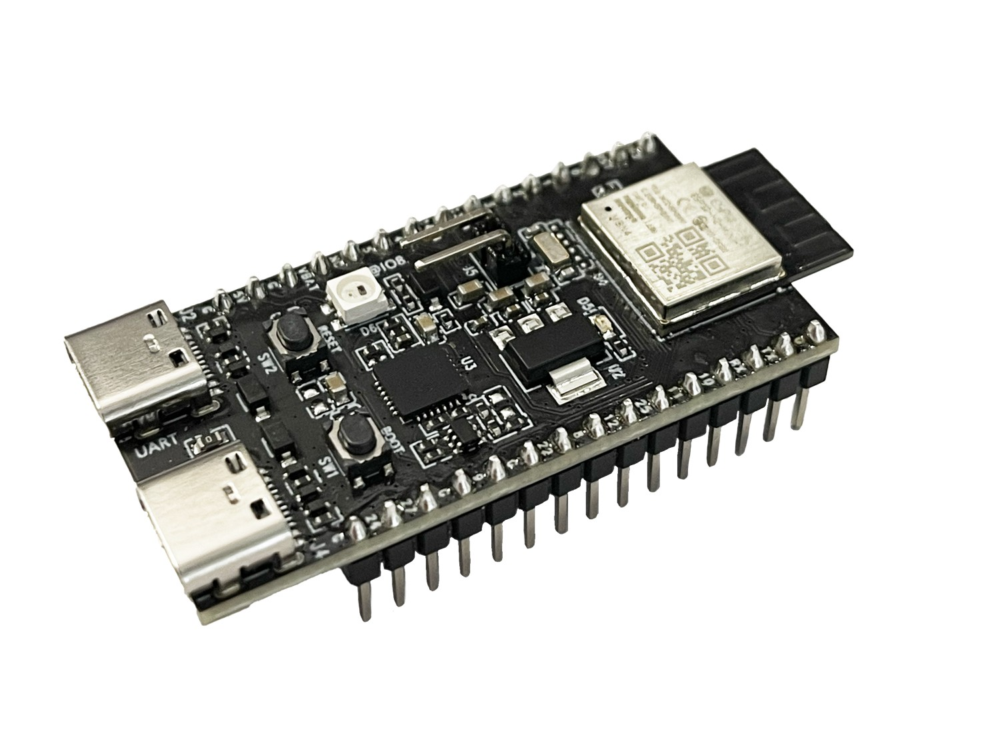

# 02 ESP32 家族与板卡选择

购买开发板时，商品标题里的“ESP32”远远不够。芯片、模组、开发板是三个层次：芯片是主要半导体器件；模组把芯片与所需的部分外围器件、射频和天线相关结构集成起来；开发板继续加入供电、USB 接口、按键和引出排针。同一款芯片可以出现在许多不同开发板上，外设和引脚可用性也会改变。

*图 02：原创层次示意，不是任何板卡的真实尺寸图。*

## 名字相近，能力不等同

下表挑出几种常见学习路线，帮助理解差异，并不声称穷尽所有已发布产品。不要把产品编号理解为单一性能排名。处理器频率、内存、无线能力和外设共同决定适用范围。[官方系列比较](https://docs.espressif.com/projects/esp-idf/en/latest/esp32/hw-reference/chip-series-comparison.html)。

| 系列 | 需要记住的差异 | 阅读时的用途 |
|---|---|---|
| 经典 ESP32 | 有 Wi-Fi、传统蓝牙及 BLE，使用 Xtensa 架构 | 理解大量早期教程的来源 |
| ESP32-S2 | 有 Wi-Fi，没有蓝牙，支持原生 USB 能力 | 理解 USB 与无线并非绑定出现 |
| ESP32-S3 | 双核 Xtensa，有 Wi-Fi 与 BLE，没有经典蓝牙 | 本书主要实验平台 |
| ESP32-C3 | RISC-V，Wi-Fi 与 BLE | 学习较精简的联网 MCU |
| ESP32-C6 | RISC-V，加入 802.15.4，与 Wi-Fi、BLE 组合 | 对照 Thread、Zigbee 与 Matter |
| ESP32-H2 | BLE 与 802.15.4，没有内置 Wi-Fi | 理解低功耗网状网络节点 |
| ESP32-P4 | 偏高性能外设与多媒体，没有内置无线电 | 理解外接无线协处理器的架构 |

后续还会有更多型号和修订。查询时同时选择目标芯片、文档版本与具体模组；不能因为开发工具菜单里支持某型号，就推断所有软件组件都已支持它。

## 同属家族，实际板子也不一样

*实物参照：C6 开发板，适合与表中的 Wi-Fi、BLE 和 802.15.4 能力对应阅读。外观接近 S3 不代表固件和排针定义相同。 图片：Espressif Systems，[来源](https://docs.espressif.com/projects/esp-dev-kits/en/latest/esp32c6/esp32-c6-devkitc-1/user_guide.html)，[CC BY-SA 4.0](https://creativecommons.org/licenses/by-sa/4.0/)；仅调整尺寸与文件格式。*

*实物参照：H2 开发板。照片里的 USB 接口用于供电、调试等连接，不能据此推断芯片内置 Wi-Fi。 图片：Espressif Systems，[来源](https://docs.espressif.com/projects/esp-dev-kits/en/latest/esp32h2/esp32-h2-devkitm-1/user_guide.html)，[CC BY-SA 4.0](https://creativecommons.org/licenses/by-sa/4.0/)；仅调整尺寸与文件格式。*

比较照片时先读模组丝印，再看接口和排针。板子颜色、金属罩大小或 USB 数量，都不能单独证明它是哪一种无线芯片。

## 读一块板的资料

拿到板卡后，先记录板上完整丝印、模组型号、存储配置、板卡修订、USB 接口标记和购买页链接。再找官方用户指南、原理图和引脚说明。模组后缀可能反映闪存、PSRAM、天线形式等配置，但应查对应型号表，而不是把某一代命名规则推广到所有产品。[官方模组料号解释](https://developer.espressif.com/blog/2025/03/espressif-part-numbers-explained/)。

以 S3-DevKitC-1 为例，USB 转串口接口和芯片原生 USB 是不同通路。能提供电力不代表当前程序的日志正通过这个端口输出；换接口后也可能需要调整 USB CDC 相关设置。板载 RGB LED 的控制方式与简单二极管不同，本书因此使用外置普通 LED，避免把板上灯的差异误认为程序错误。[开发板指南与原理图入口](https://docs.espressif.com/projects/esp-dev-kits/en/latest/esp32s3/esp32-s3-devkitc-1/index.html)。

## 引脚不是任意空位

GPIO 编号不等于排针从上往下的物理序号。一个管脚可能同时能接多个外设功能，但同一时刻仍有资源冲突。某些引脚参与上电启动配置；某些连接闪存、PSRAM 或 USB；有的仅能输入，有的在特定模组上没有引出。早期 ESP32 的“推荐引脚表”不能直接套在 S3、C3 或 C6 上。

本书基础实验采用 S3 的 GPIO4 接外置 LED，GPIO5 接按钮，GPIO6 作模拟输入示例；I2C 项目另约定 GPIO8 为 SDA、GPIO9 为 SCL。它们是书内项目分配，不是芯片的永恒默认。必须检查自己的板上有没有相连的屏幕、摄像头或其他外设；如果有，换脚并同时修改代码和记录。

选择板卡的先后顺序应是功能需求、可用引脚、内存、供电和工具支持，最后才是体积与价格。若计划连屏幕和麦克风，先算接口与缓存；若计划用电池，先考虑整板待机电流；若计划用 Matter，先区分 Wi-Fi 设备还是 Thread 设备。没有一个“最强型号”可以代替这些判断。

## 三条工具路线

Arduino 适合先建立“编译、上传、观察”的反馈循环，库丰富，但仍要辨认所用核心和库的版本。ESP-IDF 适合需要更完整控制配置、任务、驱动和产品功能的工程。MicroPython 适合交互式探索，代价是运行时资源占用、时序控制方式和可用库与桌面 Python 不同。[Arduino 官方入口](https://docs.espressif.com/projects/arduino-esp32/en/latest/getting_started.html)；[MicroPython ESP32 文档](https://docs.micropython.org/en/latest/esp32/quickref.html)。

同一项目尽量先固定一条路线。看到别人的 I2C 地址扫描程序，原理可以借鉴，代码却不能不加区分地跨框架复制。真正可迁移的是对协议、时序和错误处理的理解。

给自己的第一块板做一张资料卡：芯片、模组、Flash、PSRAM、USB 日志通路、可用 I/O、框架版本。以后排错时，这张卡比商品宣传里的“高性能”更有价值。
