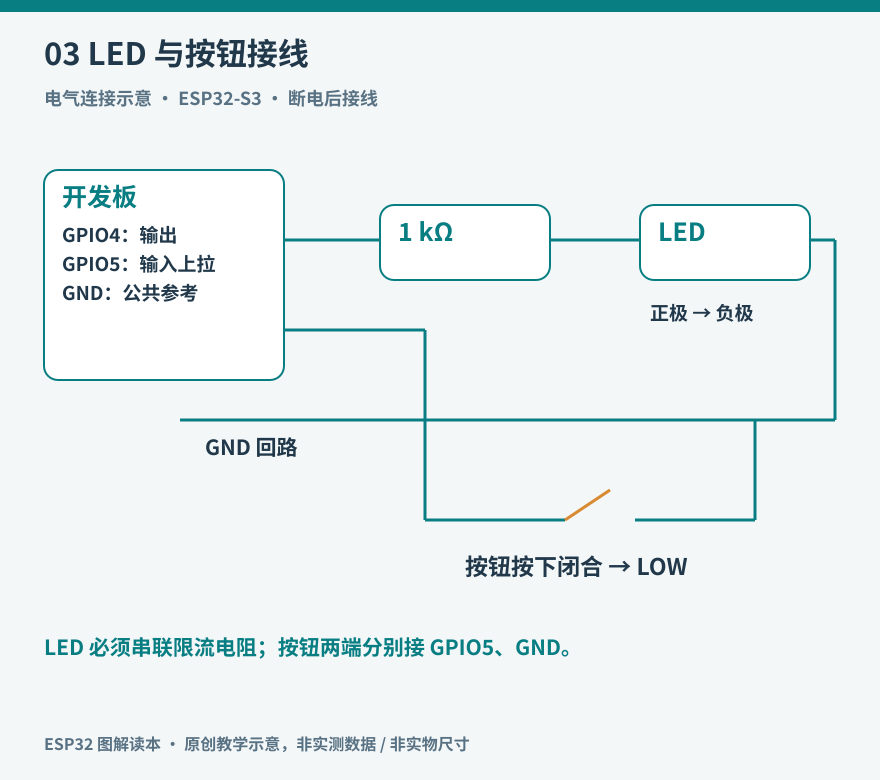

# 03 电路、供电与测量

程序改变一个引脚的状态，电路决定这个变化能产生什么效果。只懂代码而不理解电路，常见后果是灯不亮、传感器乱跳，或者负载启动时整板复位。电路基础的目标并非立即设计复杂电源，而是知道电压、电流、参考点和回路之间的关系。

*图 03：GPIO4 经限流电阻和 LED 回到 GND；GPIO5 的按钮按下时接地，使用输入上拉。图为电气连接示意，不是面包板孔位图。*

## 电压是两点之间的差

说一个节点为 3.3 V，通常是说它相对于电路 GND 的电势差。两个设备要可靠交换普通单端信号，一般需要共享参考地，或使用为隔离通信设计的接口。仅把一根“信号线”从一个板接到另一个板，若缺少约定参考，读到的高低就可能不稳定。

电流沿闭合回路流动。USB 给开发板供电，板上的稳压电路再建立芯片需要的电压。GPIO 输出高电平时，只能在允许的电压和电流范围内驱动负载。不要从“板上有 5 V 引脚”推出 GPIO 可承受 5 V。S3 的电气限制应查数据手册，而非把开发板供电口额定值当作管脚额定值。[ESP32-S3 数据手册入口](https://www.espressif.com/en/products/socs/esp32-s3)。

## 用一颗灯理解限流

LED 具有方向性，导通后电流对电压变化很敏感，因此需限流。假设 GPIO 高电平约 3.3 V，红色 LED 在当前小电流下压降约 2.0 V，串联 1 kΩ 电阻时估计电流为：

`I ≈ (3.3 − 2.0) / 1000 = 1.3 mA`

这里的 2.0 V 是教学假设，实际随型号、温度和电流变化。选 1 kΩ 是为了以较小电流观察普通指示灯；需要高亮度或多灯时，应另外核算驱动能力，不能无限缩小电阻。可用 330 Ω 到 1 kΩ 进行低电流对照，但先查 LED 及 GPIO 的约束。

断电接线：GPIO4 → 电阻 → LED 正极，LED 负极 → GND。电阻放在 LED 前或后均可，只要确实串联在回路里。上电后若灯不亮，先测 GPIO 是否变高，再检查极性、面包板连通关系和焊接，避免一开始就修改多处代码。

## 面包板不是每一排都相通

面包板中间的插孔通常按短组相连，中心沟槽把两侧分开。两边电源轨可能在中途断开，红蓝印线也不保证整条导通。把一颗电阻两端插进同一连通组，实际上就把它短接了。断电状态用万用表通断挡确认，比照着照片猜要可靠。

测电压时表笔并联在两个测点之间；测电流时仪表串入回路，并选择正确插孔和量程。把电流挡直接跨在电源两端，相当于制造低阻通路。初学阶段先完成电压和通断测量，待理解接法后再测电流。不要对已供电电路使用通断或电阻挡。

## 供电足够，不只看标签

无线发射或电机启动会产生变化的负载电流。电源适配器标称容量足够，仍可能因为线材、电压跌落或局部去耦不足导致复位。稳定供电需要从电源、线缆、连接器、稳压器到负载整体检查。乐鑫硬件指南强调电源设计、去耦与布局需要共同考虑。[S3 硬件设计指南](https://docs.espressif.com/projects/esp-hardware-design-guidelines/en/latest/esp32s3/index.html)。

基础练习只用开发板 USB 单一供电。不要同时向 USB、5 V 排针和 3.3 V 排针送入不同电源，除非已读懂该板的电源切换和防反灌电路。电机单独供电时，通常仍需按驱动方案共地，并让负载电流回路远离敏感采样路径。

本书涉及的动作实验限于低压直流。继电器模块即使看起来能“控制任何电器”，也不能把市电绝缘、接地、爬电距离和防火要求缩减成两根接线。家用高压控制超出本书动手范围。

## 第一次上电的顺序

先移除负载和传感器，只接开发板，确认能识别端口并输出日志；断电接一颗 LED，检查极性和电阻；上电运行最小程序；再逐项加入其他器件。每加入一件器件，记录空闲电压、是否异常发热以及程序有没有重新启动。

如果某次加入器件后出现故障，就先撤回到上一个已确认状态。逐级增加复杂度，让“什么时候开始坏的”变成明确证据。能够在实验记录里说清每根线的作用，比接出一个暂时亮着的电路更重要。
