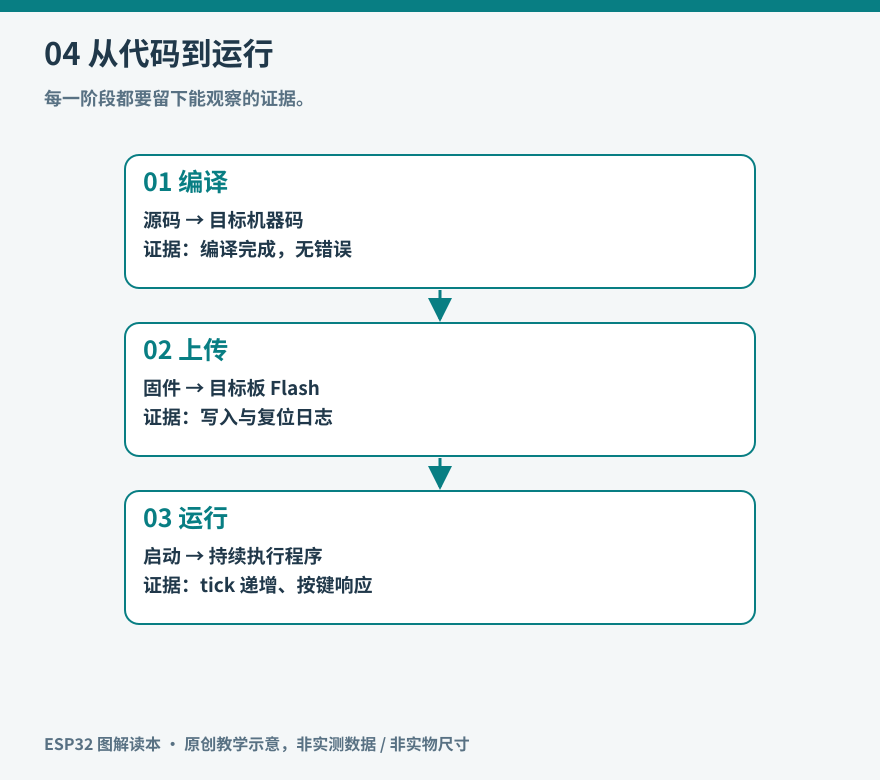

# 04 从源码到第一次运行

写在编辑器里的文字不能直接控制板子。开发工具要把源码转换成目标处理器能执行的机器码，与运行库链接，再按固件布局写进 Flash。设备重启时，引导程序找到应用并启动。把这几个阶段分清，就能区分语法错误、上传失败和运行故障。



*图 04：每个阶段都有自己的证据。编译成功不能证明接线正确，上传成功也不能证明应用逻辑正确。*

## 建立可复现的环境

安装 Arduino IDE，并按照乐鑫安装文档加入 ESP32 板卡支持，选择一个稳定的 Arduino-ESP32 3.x 版本，记录完整版本号。再选择自己的目标板与串口。本书以 S3 为例，不能选择经典 ESP32 的目标后期待生成的固件通用。[官方安装说明](https://docs.espressif.com/projects/arduino-esp32/en/latest/installing.html)。

工具链版本会影响 API、默认行为和支持范围。3.0 曾对 LEDC 等接口作过破坏性调整，因此本书不用旧教程常见的 `ledcSetup` 与 `ledcAttachPin` 组合。[官方迁移说明](https://docs.espressif.com/projects/arduino-esp32/en/latest/migration_guides/2.x_to_3.0.html)。后续若升级到其他主版本，应重新检查迁移说明，而不是只修改版本标签。

第一次只接开发板，不接外设。使用确认能传数据的 USB 线。如果电脑完全没有端口变化，先检查线、接口与驱动；不要先排查程序。使用板卡的 USB 转串口口时，串口监视器与上传工具需要访问正确端口。使用原生 USB 时，还要核对 USB 模式与 CDC 设置。

## 一个有证据的最小程序

下面是完整 sketch，也保存在 `examples/serial_hello/serial_hello.ino`。它不依赖板载 LED，运行后每秒输出一次计数。串口波特率按 115200 打开；原生 USB 的具体行为仍取决于设置。

```cpp
#include <Arduino.h>
uint32_t count = 0;
uint32_t last = 0;
void setup() {
  Serial.begin(115200);
  delay(500);
  Serial.println("boot: hello esp32");
}
void loop() {
  uint32_t now = millis();
  if ((uint32_t)(now - last) >= 1000) {
    last = now;
    Serial.printf("tick %lu\n", (unsigned long)count++);
  }
  delay(1);
}
```

`setup()` 在本次应用启动时执行一次；`loop()` 持续重复。`millis()` 提供从启动起经过的毫秒计数，它不是日期时间。用无符号减法比较相隔时间，能在约定的短时间间隔范围内处理计数回绕；不要简单写成 `now > last + interval` 后假定永远没有溢出。

先点击编译，观察是否有错误；再上传，确认写入阶段结束；最后打开监视器，观察计数增长，按复位键确认从新启动开始。若一直重新出现启动行，而计数长不起来，说明可能在复位循环，需查看完整启动日志和供电。

## 失败发生在哪一层

| 现象 | 优先检查 | 暂时不需要做的事 |
|---|---|---|
| 找不到头文件 | 库是否安装、路径和框架是否正确 | 更换硬件 |
| 目标不支持某 API | 型号、框架与库版本 | 随意改 GPIO |
| 无法打开串口 | 端口、权限、其他占用程序 | 重写业务逻辑 |
| 无法进入下载模式 | USB 通路、BOOT/RESET 流程 | 擦除所有数据 |
| 上传成功但无输出 | 日志端口、波特率、CDC 设置 | 认定芯片损坏 |
| 输出一会儿又重启 | 复位原因、供电、异常信息 | 反复忽略启动日志 |

下载模式的进入方式随板卡自动复位电路而异。需要手动时按用户指南操作 BOOT 与 RESET，而不是把按钮当作“多按几次就好”的玄学。[S3 开发板使用指南](https://docs.espressif.com/projects/esp-dev-kits/en/latest/esp32s3/esp32-s3-devkitc-1/user_guide_v1.1.html)。

## 再认识 ESP-IDF

Arduino 降低了入门接口的复杂度，但底层仍有系统与驱动。ESP-IDF 项目通常包含组件、CMake 配置、项目配置和分区表。安装对应工具环境后，在项目里使用 `idf.py set-target esp32s3`、`idf.py build`、`idf.py -p PORT flash monitor` 完成相似的循环；`PORT` 是需替换的实际设备端口。[IDF 入门](https://docs.espressif.com/projects/esp-idf/en/stable/esp32s3/get-started/index.html)。

这些命令只适用于 ESP-IDF 项目，不能直接对本书 Arduino sketch 执行。工具名称不同，验证链条相同：先证明环境能编译，再证明能写入，最后证明目标程序按预期执行。

第一次成功后，保存 sketch、板卡型号、核心版本、USB 设置和日志。以后若升级环境导致程序失效，这些记录就构成可以比较的基线。
