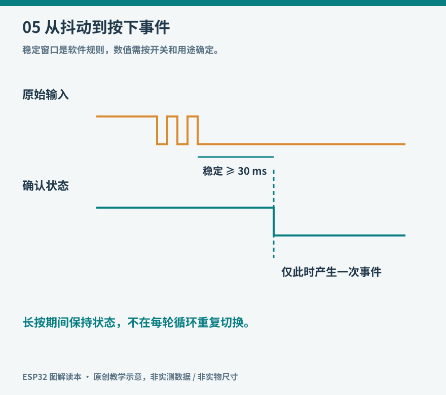
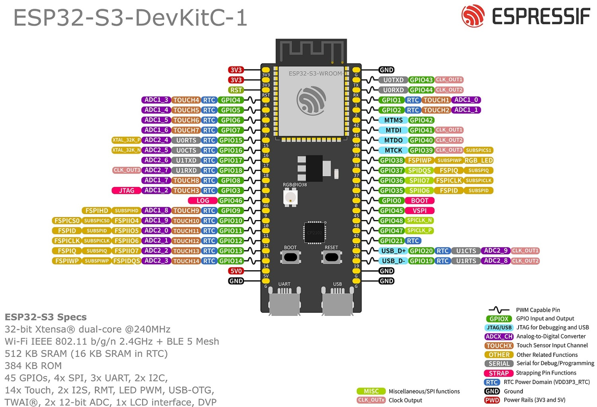

# 05 GPIO、按钮与状态机

GPIO 是通用输入输出接口。作为输出，它按程序设置驱动电平；作为输入，它判断外界电平。相同的引脚在不同配置下扮演不同角色，因此接线之前必须先知道程序将怎样使用它。一个输出高电平的脚被按钮直接短接到地，与一个带上拉的输入脚被按钮接地，是完全不同的电路。



*图 05：原始接点短时间抖动，候选状态稳定超过约定时间后才更新软件状态。横轴用于解释过程，不是实测波形。*



*实物参照：排针上的数字是 GPIO 编号。图中 GND 为地，3V3 为 3.3 V 电源，5V 为开发板电源网络，EN 为使能/复位相关信号；ADC 是模拟输入功能，TX/RX 是串口发送/接收。 图片：Espressif Systems，[来源](https://docs.espressif.com/projects/esp-dev-kits/en/latest/esp32s3/esp32-s3-devkitc-1/user_guide_v1.1.html)，[CC BY-SA 4.0](https://creativecommons.org/licenses/by-sa/4.0/)；仅调整尺寸与文件格式。*

先在实际板上定位 GPIO4、GPIO5、GND，再对照代码。彩色功能标签表示可复用能力，不表示同一个引脚能同时无冲突地执行全部功能。不能把图中的 5V 引脚当作 GPIO 可承受 5 V 的证据。

## 输入为什么不能悬空

没有上拉、下拉或外部可靠驱动的输入可能处于悬空状态，周围干扰和漏电就会影响读数。按钮实验采用 `INPUT_PULLUP`：内部上拉把松开时的电平保持为高，按下后按钮把输入接到 GND，读数变低。因此本书用 `pressed = digitalRead(BUTTON) == LOW` 表达“按下”，避免把物理含义和高低电平混为一谈。

内部上拉并不等于任何长度的外接线都不会受干扰。线很长、环境噪声很大时，需要重新设计输入保护、外部电阻和滤波。还应核对具体引脚是否具备所需功能。[Arduino GPIO 官方说明](https://docs.espressif.com/projects/arduino-esp32/en/latest/api/gpio.html)。

先用最小读取程序观察：按钮一端接 GPIO5，另一端接 GND，设置上拉；串口只在读数变化时输出。四脚轻触开关常有两脚在内部本就相通，接错方向可能导致永远短接或永远开路。断电用通断挡确认两组关系，再上电。

## 机械动作并非单次边沿

手指感觉只按了一次，金属接点却可能在短时间里多次接触和分离。若每检测到一次由高变低都切换灯，灯可能在几毫秒内切换多次，最后状态看起来随机。这就是接点抖动。软件消抖不是盲目延时，而是定义什么时候把观测当作稳定状态。

一种容易理解的办法是保存最近读数、候选状态开始时间和已经确认的状态。每次原始读数变化，重新开始计时；候选状态保持 30 ms 后，才提交为稳定状态。30 ms 是本书实验起点，不是所有开关的物理常数。短脉冲传感器不能套用这样大的消抖时间，否则真实信号会被过滤掉。

## 用状态描述行为

按钮稳定为按下之后，若每轮 `loop()` 都切换一次灯，仍会快速闪烁。程序应对“从松开变为按下”这个事件响应一次。这里至少有两个层次：输入层把抖动转换为可靠按下事件；业务层收到事件后把灯从关变开，或从开变关。

```cpp
// 局部片段：须在已初始化 GPIO 的 loop 中使用。
int raw = digitalRead(BUTTON);
uint32_t now = millis();
if (raw != candidate) {
  candidate = raw;
  changedAt = now;
}
if (candidate != stable && (uint32_t)(now - changedAt) >= 30) {
  stable = candidate;
  if (stable == LOW) {
    on = !on;
    digitalWrite(LED, on ? HIGH : LOW);
  }
}
```

完整变量声明与初始化见 `examples/button_toggle/button_toggle.ino`。启动时读取一次真实电平作为初始状态，避免把开机前已按住按钮误当作新的按下动作。本示例的约定是开机按住不会切换，必须先松开再按。

## 从开关扩展到状态机

状态机用有限的状态和事件描述系统行为。例如浇水设备可有空闲、浇水、等待恢复和故障状态。只有状态允许时某个事件才触发动作；传感器断线时不能继续沿用“上一次偏干”的值无限浇水。状态机最大的价值是让例外和停止条件显式出现。

不必一开始就采用复杂框架。一个 `enum` 加 `switch`，配合进入状态的时间，已经能清楚表达许多项目。应尽量让输出由当前状态统一决定，避免网络回调、按钮处理和定时任务各自改写电机引脚，否则系统状态会变得难以追踪。

中断适合需要及时捕获的事件，但中断函数里不宜执行复杂日志、网络和长时间等待。可以只记录事件或通过合适机制通知任务，后续再处理。并发访问也不能只加一个 `volatile` 就认为有完整同步；第十五章再讨论共享资源。

## 检验一次按下

连续按十次，每次松开后等半秒，灯应准确切换十次。再长按三秒，灯应只切换一次。最后按住按钮再复位，确认行为符合前述启动约定。记录异常发生在快速连按、长线还是开机时，这些条件能帮助判断是电路噪声、消抖策略还是状态逻辑问题。

至此，点灯从“让引脚变化”推进到“把真实动作变成明确事件”。后面的网络、定时和传感器事件都可以沿用这一方法。
