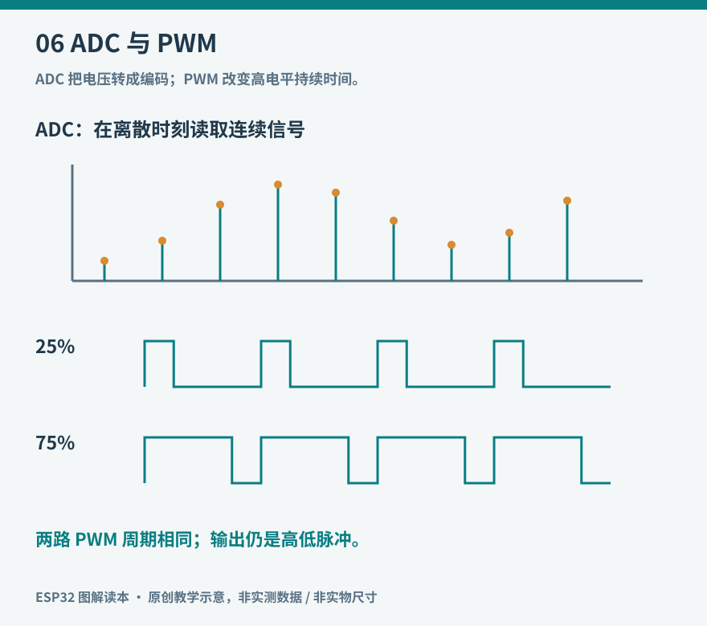

# 06 模拟量、ADC 与 PWM

数字输入适合判断开或关，真实世界却经常连续变化：光照、旋钮角度和电池电压都不是两个状态。ADC 把输入电压映射为数字编码；PWM 则用一串高低脉冲的时间比例控制平均作用。它们方向相反，却不是互为完全对称的“模拟接口”。



*图 06：上半部分解释采样与量化，下半部分比较同频率、不同占空比的 PWM。示意不代表 ESP32 的真实噪声或电压范围。*

## ADC 读数是什么意思

ADC 的位数决定可用编码数量，例如理想 12 位转换可区分 4096 个编码。但读到 2048，不代表所有芯片、衰减设置和输入范围下都精确等于 1.65 V。实际转换还受参考、非线性、噪声、输入范围与校准影响。[S3 ADC 单次采样驱动](https://docs.espressif.com/projects/esp-idf/en/stable/esp32s3/api-reference/peripherals/adc/adc_oneshot.html)。

分辨率和准确度不同。把显示小数位加到六位，不会凭空改善测量。平均多次采样能降低某些随机噪声，却不能纠正错误接线、超量程或固定偏差。经过校准的毫伏值依然要在允许的工作范围内使用。

## 一个不会把旋钮直接顶到电源轨的实验

准备 10 kΩ 线性电位器、两只 10 kΩ 电阻和万用表。先用两只电阻把 3.3 V 分压得到空载约 1.65 V 的节点，再把电位器的两端接该节点与 GND，滑动端接 GPIO6。接入后，电位器的总电阻与下方 10 kΩ 电阻并联，理想等效为 5 kΩ，因此该节点约为 1.10 V，滑动端约在 0～1.10 V 间变化；实际值还受器件误差和采样负载影响。它用于观察连续变化，不是校准基准。

更简洁的定量实验是只接两只固定电阻分压，中点接 GPIO6，用万用表同时测中点电压，比较原始 ADC 值与校准毫伏读数。所有连接必须共地。绝不能把 USB 5 V 直接送进 ADC，也不能把软件衰减设置理解为管脚耐压提升。具体有效范围见相应芯片和 Arduino ADC 文档。[Arduino ADC](https://docs.espressif.com/projects/arduino-esp32/en/latest/api/adc.html)。

```cpp
// 局部片段：Arduino-ESP32 3.x / ESP32-S3。
analogReadResolution(12);
analogSetPinAttenuation(6, ADC_11db);
uint16_t raw = analogRead(6);
uint32_t millivolts = analogReadMilliVolts(6);
```

两次函数调用取得的是两次采样，输入有变化时不能把它们当作同一次转换的不同表示。这里使用 Arduino 接口的 `adc_attenuation_t` 枚举值 `ADC_11db`，不要与 ESP-IDF 的 `adc_atten_t` 枚举混用。Arduino 官方表列出 S3 在该设置下的可测范围约为 0～3100 mV，不是任意 0～3.3 V 输入都能准确测量；复制代码前仍须核对所安装版本。

## 采样快慢会改变你看到的世界

每秒读一次温度可能足够，每秒读一次声音就完全失去波形。采样率描述每秒取得多少次观测，必须与信号变化速度匹配。存在超过可辨识频率的成分时，会发生混叠：高频变化在采样后伪装成低频。实际测量还可能需要模拟低通滤波，不能单靠事后平均补救全部问题。

本书的温湿度项目测慢变量，不用追求最高采样率。先确认传感器自身更新周期，再选择采样与上报周期。每秒采样、每分钟报告一次平均值，与每分钟只采样一次，记录到的信息并不相同。

## PWM 控制的是时间比例

设周期为 1 ms，高电平持续 0.25 ms，占空比就是 25%，频率为 1 kHz。同频率提高占空比，普通 LED 的平均亮度一般提高，但人眼对亮度的感觉不是线性的。若拍摄时出现条纹，可能与 PWM 和相机曝光相互作用有关，而非灯真的坏了。

Arduino-ESP32 3.x 可用以下完整调用关系初始化 LEDC，再按引脚写入占空比。这里用 GPIO4、5 kHz、8 位分辨率，范围为 0 到 255。频率与分辨率存在资源限制，必须检查初始化是否成功。[Arduino LEDC](https://docs.espressif.com/projects/arduino-esp32/en/latest/api/ledc.html)。

```cpp
// 局部片段；初始化放在 setup 中。
bool ok = ledcAttach(4, 5000, 8);
if (ok) ledcWrite(4, 64);
```

PWM 输出仍在高低电平间切换，不是自动得到平滑的模拟电压。需要模拟电压时可能要滤波、缓冲或外部 DAC；电机调速则需要兼容的功率驱动，而且不能把任意 PWM 参数套给所有风扇。

## 用观察建立尺度

将外置 LED 依次设为 0、16、64、128、255，观察亮度变化是否等距。再把 ADC 原始值和毫伏值连续记录几十次，比较固定输入下的抖动范围。若输入波动很大，先查接地、电源、导线和输入是否悬空。

模拟测量需要回答的不只是“有没有数字”，还包括数字的单位、有效范围、变化速度和误差来源。把这些写进记录，传感器数据才有继续分析的意义。
