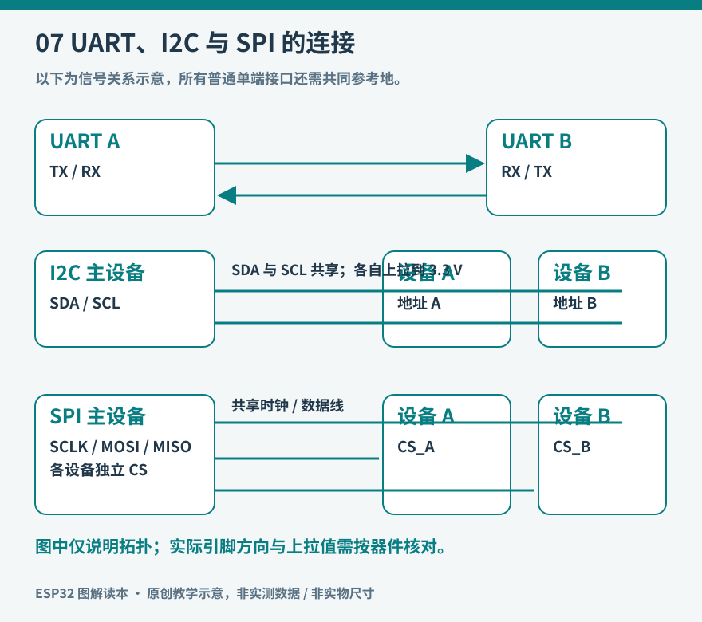

# 第7章 UART、I2C与SPI：让器件交换信息

把 LED 接到引脚上，程序只需决定亮或灭。换成温湿度传感器，问题就复杂了：它一次要传出几个数，还要告诉主机正在读哪个寄存器。总线把这些约定组织成双方能够理解的时序，让少量导线传递成组信息。

这里先分清三个层次。导线上容许多高的电压，属于电气条件；第几个时钟读哪一位，属于传输规则；某个字节表示温度还是配置，属于器件协议。两块板都写着“串口”，并不意味着能直接互连；同样使用 I2C 的两个传感器，也不一定有相同寄存器。


*实物参照：这是 Adafruit BME280 模块的一种版本。正面既有测量芯片，也有电源与接口外围器件，不能把整块转接板当作裸芯片。 图片：Kattni Rembor / Adafruit，[来源](https://learn.adafruit.com/assets/97115)，[CC BY-SA 3.0](https://creativecommons.org/licenses/by-sa/3.0/)；仅调整尺寸与文件格式。*

图中 `VIN` 是本模块电源输入，`GND` 是地；I2C 模式下 `SCK` 对应时钟 SCL，`SDI` 对应数据 SDA。`SDO` 和 `CS` 的用途随接口模式而变化，按厂商说明配置。两侧白色小连接器是同一条 I2C 总线的便捷接口，不是两套独立传感器。不同厂商可能直接印 SCL/SDA，不能只凭孔位顺序照抄。




*图7：原创教学示意。图中信号关系不代替具体板卡的引脚图；三个接口都需要适当的电源与参考地。*

## UART：双方先约好速度

UART 常用 TX 发送、RX 接收，连接两个 3.3 V 逻辑设备时，A 的 TX 接 B 的 RX，B 的 TX 接 A 的 RX，并共地。没有另外一根共享时钟，因此双方必须事先约定波特率、数据位、校验和停止位。常见的 115200、8N1，意为每秒约 115200 个符号、8 个数据位、无校验、1 个停止位。[Arduino-ESP32 UART 文档](https://docs.espressif.com/projects/arduino-esp32/en/latest/api/serial.html)给出了 `HardwareSerial` 配置方法。

以常见的一起始位、八数据位、一停止位为例，一个字节占十个位时间，115200 波特的理想字节吞吐量约为每秒 11520 字节，而不是 115200 字节。日志太密时，打印本身会拖慢程序。

UART 提供字节流，没有替你规定“这一条消息在哪里结束”。接收端可能先收到半行，随后收到剩余半行，也可能一次收到几行。可以为初学项目约定换行结束一条文本消息，并限制最大行长；二进制协议则通常有帧头、长度、类型和校验。超长或超时的半帧应丢弃，避免一直占着缓冲区。

USB 接口也别混为一谈。开发板可能用 USB 转 UART 芯片，也可能用 ESP32-S3 的原生 USB 功能呈现串口；`Serial` 的实际去向受板卡和构建选项影响。TTL UART 不等于使用正负电压的 RS-232，也不能直接接 RS-485 的 A/B 差分线。

## I2C：两根信号线，多台有地址的设备

I2C 使用 SCL 时钟和 SDA 数据。主机发起一次事务，给出目标地址和读写方向，被寻址的设备再响应。SDA、SCL 采用开漏方式，需要上拉到合适的逻辑电压；连接到 ESP32 时，不能因为某块模块能用 5 V 供电，就默认它的总线上拉也是安全的 3.3 V。[Arduino-ESP32 I2C 文档](https://docs.espressif.com/projects/arduino-esp32/en/latest/api/i2c.html)说明了引脚、时钟、事务和返回值。

地址最常见的写法是七位地址。一些数据手册把读写位也算进八位数值，直接抄入库参数就会错位。读表时要确认文档采用哪一种表示。两台固定地址相同的设备也不会自动获得不同号码，需要改变地址配置、分开总线，或加总线多路复用器。

下面是独立的 Arduino-ESP32 3.x 扫描程序。它采用本书 ESP32-S3-DevKitC-1 的 GPIO8、GPIO9 作为实验接线，使用前仍要核对你的板卡原理图和外设占用。仅连接支持 3.3 V 总线的模块，先断电接线：3V3→模块合适的供电脚，GND→GND，GPIO8→SDA，GPIO9→SCL。模块若没有上拉，按其数据手册补上拉；模块已有上拉时，不要机械地再并一组。

```cpp
#include <Arduino.h>
#include <Wire.h>

void setup() {
  Serial.begin(115200);
  if (!Wire.begin(8, 9, 100000)) {
    Serial.println("I2C initialization failed");
    return;
  }
  for (uint8_t address = 0x08; address <= 0x77; ++address) {
    Wire.beginTransmission(address);
    uint8_t result = Wire.endTransmission();
    if (result == 0) {
      Serial.printf("ACK at 0x%02X\n", address);
    }
  }
}

void loop() {
  delay(1000);
}
```

扫描到 ACK，只能说明这个地址在那一刻有人响应，不能证明型号正确，更不能证明温湿度读数可信。进一步应读取芯片识别寄存器，并检查库所期望的型号。完全扫不到时，先查供电、共地、SDA/SCL 对调、地址配置和上拉，再考虑软件库。

## SPI：多几根线，换取直接的时钟传输

SPI 常见信号是 SCLK、MOSI、MISO 和片选 CS。主机控制时钟及片选，数据可以在发送的同时接收。屏幕这类主要接收数据的器件可能不需要接 MISO；不同器件还可能有额外的复位、命令/数据选择脚。

多个外设可以共享时钟和数据线，但通常各自占用片选。只允许本次被选中的设备驱动共享返回线。开始前还要匹配时钟极性、采样边沿、位顺序以及最高频率，不能把“SPI 接好了”理解为所有设备都采用同一模式。[官方 SPI 示例](https://docs.espressif.com/projects/arduino-esp32/en/latest/api/spi.html)演示了事务设置和片选管理，其中部分引脚注释针对原始 ESP32，不能原样套给 S3。

第一次调试时先选较低时钟、短线和一个外设。能稳定读取芯片 ID 后，再逐步提高频率。若低速正常、高速错码，优先考虑线长、接地、边沿和器件时序。软件重试可能掩盖问题，却不能修复信号完整性。

## 用任务选择接口

| 需要解决的问题 | 常见选择 | 需要额外确认 |
| --- | --- | --- |
| 模块之间发送日志、定位信息 | UART | 电平、波特率、消息边界 |
| 同板连接若干低速传感器 | I2C | 地址冲突、上拉、总线电容 |
| 连续刷新彩色屏幕或访问高速外设 | SPI | 模式、片选、频率和走线 |

这些不是排他的用途。一颗 BME280 同时提供 I2C 与 SPI，可以按板上引脚、距离和其他外设选择。接口速度也不是唯一标准：只有四个字节需要每秒读一次，较高的总线标称速率不一定改善体验。

一个有收获的观察是：先让单个 I2C 模块响应，再加入第二个，最后让其中一个断开。记录扫描结果和读取超时如何变化。你会看到“设备不存在”“总线被拉住”“收到数据但内容不合法”是不同故障，应该保留不同错误信息。本章代码未经过实物运行验证；读者实验时应把板卡型号、核心版本与结果一起记录。

## 看懂一次寄存器读取

不少传感器把内部功能排列成寄存器地址。读取某项结果时，主机先告诉器件“下一步从哪个地址开始”，再取回若干字节。有些器件要求这一过程在重复起始条件下连续完成；有些库已经封装好。不要仅凭“它也是 I2C”就自行删掉某一步。寄存器地址与总线设备地址是两个层次，前者选内部位置，后者选总线上的器件。

取回两个字节后，还需要核对高低字节顺序、有无符号、有效位数及单位。例如两个字节可能合成一个十六位有符号值，也可能只有其中十二位有效。把它们直接拼成整数可以得到一个数字，却未必得到正确物理量。设备数据手册中的通信章节和数据格式章节，应放在一起读。

排障时保留一份原始十六进制输出，可以把“总线没传对”与“换算公式用错”分开。若原始寄存器长期完全不变，先确认是否需要触发新转换；若原始值变化合理而物理量异常，再检查换算、校准系数与整数溢出。

最后不要把板内总线理解成远距离布线方案。把一米跳线接上 I2C 后偶尔读通，不能据此证明它适合整个房间。更远距离、强干扰或不同地电位的连接，往往需要差分收发器、隔离或另一种网络架构。接口选择包含电气环境，而不只有软件库名字。
