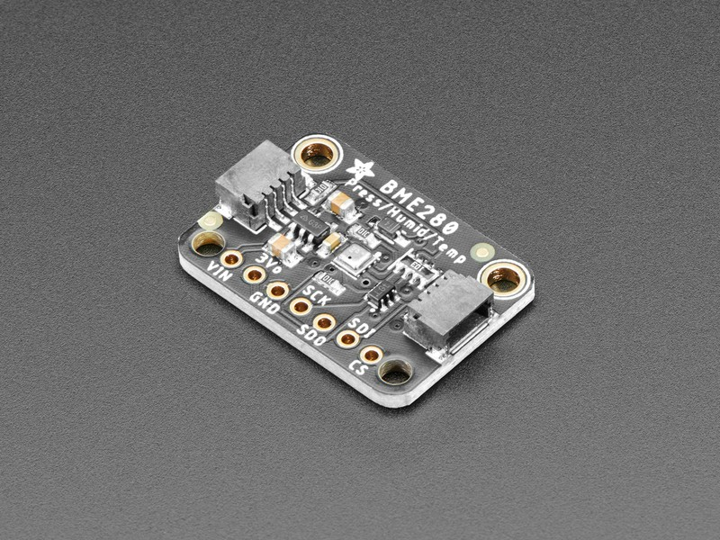
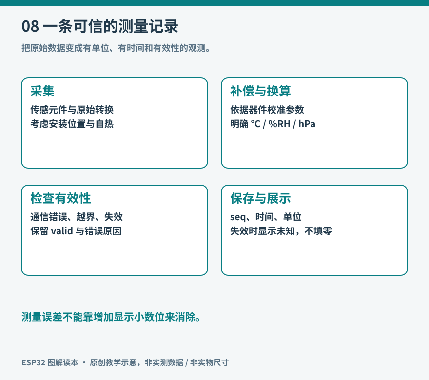

# 第8章 传感器与数据可信度

桌面温度计显示 25.37 ℃，小数位很多，读数却可能受 USB 稳压器发热影响。传感器真正测量的是它所在位置的某种物理量；程序读取的是转换后的数据。数字看起来稳定，不等于环境没有变化；数字看起来精细，也不等于误差很小。

*实物参照：中央较小的金属封装器件才是主要传感元件，四角大孔用于安装，周围器件承担供电和接口等功能。 图片：Kattni Rembor / Adafruit，[来源](https://learn.adafruit.com/assets/97111)，[CC BY-SA 3.0](https://creativecommons.org/licenses/by-sa/3.0/)；仅调整尺寸与文件格式。*

观察传感器时先找测量元件与开孔位置。安装时避免胶水、外壳或热源妨碍空气交换；模块看起来有金属罩，并不意味着整板防水。照片只用于识别本模块外观，不能据此区分所有外观近似的 BME280 与 BMP280，仍需核对型号和读回身份。

*图8：原创教学示意。数值处理与“这次测量是否仍然有效”必须一起保留。*

## 先问它到底在测什么

温度、相对湿度、气压、照度、距离、加速度，看似都能用一个数字表示，测量条件却不同。光敏电阻可以观察明暗变化，未经光谱和结构校正的读数不宜直接标成标准照度 lux；土壤电容探头可以追踪某盆植物的相对变化，未经介质标定不能自然变成普适的含水百分比。

同样，气体模块的“空气质量值”不应直接当作二氧化碳浓度。要先看敏感元件、输出物理量和厂商给定条件。把输入变量命名成 `co2_ppm` 并不会使一个非 CO₂ 传感器获得这种测量能力。选型的第一步，是写出“我想知道什么”，再找能测它的器件。

以 BME280 为例，Bosch 将它定义为温度、湿度和压力传感器，提供 I2C/SPI；内部温度测量也用于压力、湿度补偿。它并不测量 CO₂ 或颗粒物。[Bosch 产品页](https://www.bosch-sensortec.com/en/products/environmental-sensors/humidity-sensors-bme280/)与[数据手册](https://www.bosch-sensortec.com/media/boschsensortec/downloads/datasheets/bst-bme280-ds002.pdf)分别给出功能概况和适用条件。

## 把“好不好”拆成不同指标

| 指标 | 它回答的问题 | 常见误解 |
| --- | --- | --- |
| 量程 | 多大范围内可以测量 | 在量程内就一定有相同精度 |
| 分辨率 | 最小能表示多小的变化 | 小数越多越准确 |
| 准确度或误差范围 | 与参考值可能差多少 | 所有环境条件下都满足首页数字 |
| 重复性 | 相同条件下是否接近 | 每次相同就没有系统偏差 |
| 响应时间 | 变化后多久跟得上 | 每秒读一百次就能响应一百次 |
| 漂移 | 长期使用后偏差如何改变 | 初次校准后永久不变 |

设两台温度计长期分别显示 25.0 ℃ 和 25.8 ℃。它们之间相差 0.8 ℃，并不能据此知道哪台正确。只有拿到条件合适、误差足够小的参考仪器，才能进一步判断。把所有数据都减去 0.8，也可能只修正了一个温度点的偏移，而没有修正其他温度下的误差。

## 一个读数从哪里来

数字传感器内部通常包含敏感结构、信号调理和转换逻辑。主机还可能要读取出厂校准系数，再使用规定算法得到物理量。BME280 的官方[Sensor API](https://github.com/boschsensortec/BME280_SensorAPI)展示了初始化、读写接口与补偿处理。使用成熟库能减少重复工作，但仍应检查型号、地址、单位和错误返回值。

建议先按下面的顺序建立最小数据链：

1. 读取芯片身份，确认总线上连接的型号。
2. 选择工作模式、采样配置和测量周期。
3. 触发测量或等待新数据可用，不把上次结果当作刚完成的结果。
4. 检查通信错误，再取得原始值或补偿后的物理量。
5. 附上采样时间、序号和有效标志，最后才交给显示、存储和网络。

“读取成功”和“值可信”是两道检查。总线事务成功时，模块仍可能尚未完成转换；一个浮点数也可能是非有限值。没有依据时不要把越界数据强行截到合理范围，那会把故障伪装成漂亮的曲线。

## 布置位置往往比滤波更重要

要测室温，就要让传感器尽量感受室内空气。靠近发热芯片、被手握住、贴着窗玻璃、放在太阳照射的黑色外壳中，测到的都会包含局部效应。湿度测量还受通风和温度影响。相对湿度表示当前水汽含量与该温度下饱和状态的关系；温度变化时，即使没有增加水汽，相对湿度也可能变化。

可做一个不依赖昂贵设备的观察：保持程序不变，把传感器从主板旁边移到短线另一端，并维持相似通风条件。等读数稳定后比较两组结果。这个实验不能提供绝对校准，却能揭示安装方式是否影响你要观察的现象。不要用吹热气或结露作为常规测试方法，以免把温湿度与污染影响混在一起。

## 滤波让曲线平滑，也会拖慢反应

简单的五点移动平均，使用最近五次测量的平均值作输出。它可以减小某些短期波动，却会让突变逐步显现。若每十秒采样一次，五点窗口跨越了四十秒的采样间隔；对缓慢室温变化或许合适，对电机堵转保护就可能太迟。

指数平滑可以写成 `filtered = α × current + (1−α) × previous`。较小的 α 让历史占比更大，变化也更慢。选择参数前，先说明允许多大延迟。还要保留原始数据，避免只凭平滑曲线分析异常。

滤波不能修正持续偏高的传感器、错误单位或错误接线。如果温度始终恰好放大一百倍，先检查库返回的是摄氏度还是百分之一摄氏度；如果数值突然变为巨大负数，先检查有符号解释和字节顺序。

## 让失败可见

本书项目采用以下概念数据结构：温度、相对湿度、采样时间、有效标志、错误原因。这不是额外负担，而是防止数据在系统间传递后失去语境。上次成功测量是十分钟前时，屏幕可以继续显示它，但应同时显示“旧数据”；不要继续滚动新的时间戳。

对于一秒采样一次的教学记录器，可以先约定：本次失败时保存错误，不写假零值；连续失败时显示故障；重新成功后恢复显示，并保留失败计数。零摄氏度本身可能是真实测量，用零代表错误就把这两种情况混在一起了。

完成本章后的检查不在于屏幕是否出现一个温度，而在于：拔下传感器后程序会不会如实报告；插回后能否恢复；切换单位后是否保持一致；旧数据能否与新数据区分。这几项比增加一位小数更能提高记录的价值。

## 把一次测量写成可重复的小实验

想比较两种采样配置，不要一边改变位置、一边改变滤波窗口。可以先固定传感器位置、电源和记录间隔，保留原始值与输出值，记录足够长的一段稳定环境；然后只改变一个配置，再重复。把试验条件写在数据旁边，后续才有办法解释差别。

例如判断平均滤波是否有用，可以观察稳定时段内读数的波动，并在一次可控环境变化后比较两条曲线的延迟。波动变小而响应变慢，是可能同时发生的结果；不能只截取平滑的部分宣称“精度提高”。读数之间有相关性时，多次平均带来的改善也不会简单等同于重复次数增加。

采样频率还要服务物理过程。室温记录每几秒或几十秒一次可能已经足够，机械振动则涉及更高频率与抗混叠问题。若采样频率低于所观察变化的需要，高频变化可能被错误地表现成低频模式。换成更快的 MCU 并不会自动补回已经丢失的信息。

对于慢速兴趣项目，可以先画“采样时刻”和“读数提交时刻”两列。网络不稳定时，数据到达服务器的间隔会变化，但传感器本地采样可以仍然均匀。把接收时间当成采样时间，会将网络抖动误读为环境变化。

进一步阅读时还会遇到溯源和不确定度：它们关注测量结果与参考体系的联系，以及结果可信范围如何表达。家庭观察不必从复杂计量报告起步，但应保留这种意识：数值的意义来自测量条件、处理过程和边界。
