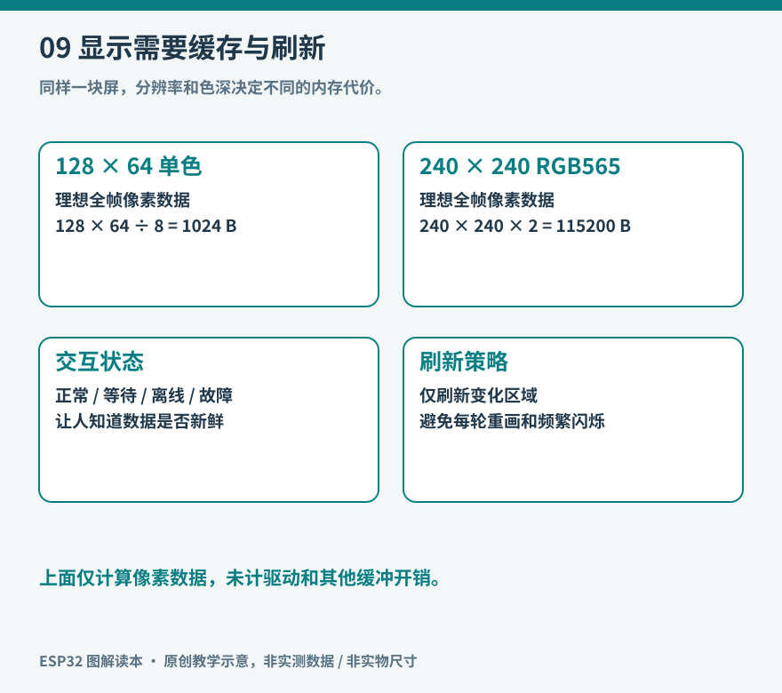

# 第9章 屏幕、灯光与人机交互

一个联网温度计可以有绚丽仪表盘，也可以只有两盏指示灯。它们是否好用，首先取决于用户能不能判断：当前测到什么，设备正在做什么，刚才的操作是否生效。输出信息不只是把变量画出来，还要把系统状态解释清楚。

## 从使用距离决定表达方式

桌面设备上，数值与文字适合近距离阅读；隔着房间判断设备是否在线，较大的指示灯更直接。蜂鸣器适合短暂提示，却不适合持续报告每次网络重试。振动、灯光、声音和屏幕可以各司其职，但不应让同一事件触发一串让人无法关闭的反馈。

颜色也需要文字或节奏配合。仅用红绿区分故障和正常，对色觉差异者不友好；缓慢闪烁、常亮、明确的“离线”标签，能增加区分线索。闪灯次数过多时，人也很难记住。可先把状态压缩成“启动、正常、离线、故障”四类，再决定是否需要细分。

*图9：原创教学示意。容量为完整像素缓冲的理论值，实际内存还包括驱动、字体、队列和对齐开销。*

## 显示屏的名字不等于接口

OLED、LCD、电子纸描述的是显示技术；I2C、SPI、RGB 并行等描述主机与屏之间的连接方式；SSD1306、ST7789 等又属于控制器或驱动芯片型号。买屏幕时至少需要确认技术、像素分辨率、控制器、接口、电压和连接器定义。两块同样大小的“1.3 英寸屏”不一定能使用同一个初始化过程。

ESP-IDF 的 [`esp_lcd` 文档](https://docs.espressif.com/projects/esp-idf/en/stable/esp32s3/api-reference/peripherals/lcd/index.html)把显示控制与像素传输组织为驱动框架，也说明了控制器仍可能需要面板专用初始化。接口受具体芯片支持范围限制，不能因为通用文档列出某种接口，就认为每一款 ESP32 都原生具备它。

对第一次实验，低分辨率单色屏更容易看清数据路径；彩屏适合后续学习字体、图表、触摸和局部刷新；电子纸适合更新缓慢的阅读或状态用途，但其刷新波形、残影和刷新次数管理要遵循实际面板规格。不要按“颜色更多”给这些选择排高低。

## 先算一帧图像要多少内存

128×64 像素、每像素一位的单色缓冲，理论容量为 `128×64÷8 = 1024` 字节。240×240 像素、RGB565 格式的彩色缓冲，每像素两字节，需要 `240×240×2 = 115200` 字节，约 112.5 KiB。换成 320×240，则是 153600 字节。字体、网络和其他任务还要继续占内存，不能把 RAM 全部划给画面。

完整帧缓冲方便绘制，也可以只用一块较小缓冲分条刷新；双缓冲则用更多内存让绘制与传输交错。是否需要 PSRAM，要根据实际分辨率、色深、缓冲策略和并行负载计算，不是所有“带屏 ESP32”都必须使用同一种内存方案。[LVGL 的 ESP32 集成文档](https://lvgl.io/docs/open/integration/chip_vendors/espressif/add_lvgl_to_esp32_idf_project)说明了图形库与显示、触摸驱动之间的分工。

带宽也能先估算。假设要完整传输一张 240×240 RGB565 图像，共 921600 位；即使 SPI 实际有效负载达到每秒 20 Mbit，传输本身也要约 46 ms，尚未计命令、任务等待和绘制。因此，追求每秒刷新几十次前，先问有多少像素真的变化。每秒更新一次温度，不需要每次重画全部背景。

## 从最小画面逐层接通

显示调试可以按以下顺序进行：

1. 核对电源和背光条件，区分“背光亮”与“屏幕收到像素”。
2. 运行适配控制器的纯色或线框测试，确认尺寸、方向、偏移和颜色顺序。
3. 只画一个固定数字，排除字体和布局问题。
4. 接入真实数据，但先不加网络、触摸和动画。
5. 最后加入状态提示与局部刷新，并测量更新时间。

若红色显示成蓝色，先检查颜色通道顺序；图像整体偏移，先检查面板坐标窗口；背光亮但完全无内容，则从复位、片选和初始化查起。乱码可能来自字库和编码，也可能是传输错误，不能只换字体碰运气。

官方[同一 SPI 总线上的 LCD 与触摸例程](https://github.com/espressif/esp-idf/blob/master/examples/peripherals/lcd/spi_lcd_touch/README.md)可以作为真实结构参考：显示和触摸共享总线，并不表示它们共用一个片选或使用完全相同的器件协议。

## 刷新要有节制，按钮要有回应

可以让传感器每秒产生一次新读数，屏幕只在数据或状态变化时刷新。按钮按下后先给出“正在连接”或按下反馈，再等待耗时操作结束。若必须等网络请求返回才更新界面，用户会以为按钮没有响应，继而连续按很多次。

界面应区分“用户要求的状态”与“实际状态”。风扇目标设为开启，不等于电机已经转动；请求发送成功，不等于远端完成操作。没有转速传感器时，可以写“输出已开启”，不宜写“风扇正常运行”。

单个 LED 的 PWM 调光可使用 Arduino-ESP32 3.x 的 [`ledcAttach()` 和 `ledcWrite()`](https://docs.espressif.com/projects/arduino-esp32/en/latest/api/ledc.html)。可寻址 RGB 灯珠则通常使用专门的串行时序，不能当成三只普通 LED 直接套三个 PWM。灯带长度增加后，还要核算供电电流、电平和压降。

## 给一块小屏建立信息层级

以环境终端为例，第一行显示温度和单位；第二行显示湿度；角落显示联网状态；底部只在数据过期或传感器异常时出现提示。配置页才展示 IP、固件版本等信息，不让日常阅读被调试字段挤满。

可以做一次“断网五分钟”的阅读检查：不知道内部实现的人，能否从界面区分环境值没有变化与数据已经过期？再遮住颜色，仅看文字和图形，状态是否仍可理解？这两次观察比单纯增加动画更能揭示交互问题。

完成后，你应当能解释画面经过哪些步骤抵达屏幕，也能指出某个图标究竟对应哪项真实状态。漂亮界面有价值，而可信、及时和可读构成它的基础。

## 把输入处理与绘制分开

一个简单界面可以保留一份当前状态：当前页面、选中项目、测量值、联网状态和最近错误。按钮事件只修改这份状态，绘制过程根据状态生成画面。这样，同一个“返回”动作就不需要散落在多处绘图代码里，也较容易记录和复现问题。

如果屏幕一刷新就闪烁，先检查是否不断清空整屏再慢慢重画。可以先在缓冲中画好，或仅更新变化区域。若按钮偶尔触发两次，则应回到输入消抖与事件定义，而不是在界面里加更长的全局延时；延时会让其他反馈一起变迟钝。

中文显示还有字形覆盖问题。默认的小型西文字体通常没有中文字符，程序正确地收到 UTF-8 字节，也不意味着屏幕库能直接绘出中文。应选择支持所需字形的字体和绘制方式，按用途保留必要字符，并核算字库占用。单位“℃”与两个字符“°C”也可能使用不同字形。

触摸输入则需要把控制器报告坐标映射到当前屏幕方向。旋转画面后，触摸坐标如果没有同步变换，就会出现“点右边，左边响应”。先用四角和中心测试触点，再加入按钮布局，比在完整界面中猜测偏移更直接。小按钮即使视觉上排得下，也可能因为手指遮挡而难以可靠操作。

最终检查可以列出启动、正常、等待、失败、恢复五种画面，并在程序中逐个触发。它们不是五套独立皮肤，而是同一设备的真实状态。用户最需要信息的时刻，往往正是失败与等待时。
