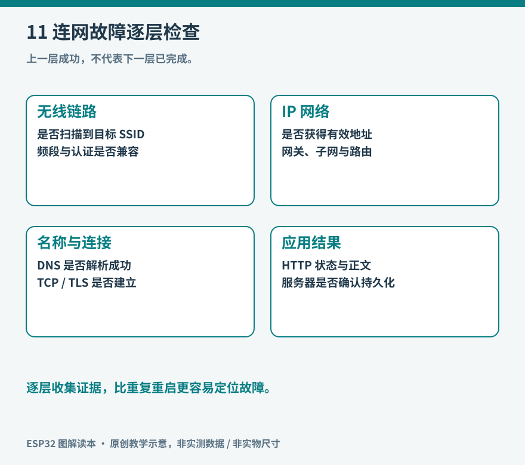

# 第11章 Wi-Fi与网络基础

“Wi-Fi 已连接”是一个进展，却不是联网任务已经完成的证据。设备可能连上了路由器，却没有得到 IP；可能有 IP，却无法解析域名；可能能访问服务器，却因凭据失效被拒绝。把这些阶段分开，联网故障才会变得可解释。

*图11：原创教学示意。任一阶段成功，只说明该阶段的条件已经满足。*

## 先确定设备扮演什么角色

ESP32 以 Station，简称 STA 模式连接现有接入点时，行为类似手机加入家庭 Wi-Fi。以 SoftAP 模式工作时，它自己提供无线接入，手机可以连过来读取页面或配置网络。SoftAP 不会自动变成互联网路由器，手机连上设备也不等于能通过它上网。[Arduino-ESP32 Wi-Fi API](https://docs.espressif.com/projects/arduino-esp32/en/latest/api/wifi.html)分别介绍这些模式。

本书主实验板 ESP32-S3 使用 2.4 GHz Wi-Fi。家庭路由器可以同时提供多个频段，但如果你只启用了 5 GHz 网络，S3 无法因为网络名称相同就获得 5 GHz 无线能力。ESP32 家族的无线能力并不完全相同，不能把这项结论当成所有新型号的永久限制；选型仍应查具体芯片资料。

第一次连接宜用一个你能管理、无需网页二次认证的 2.4 GHz 网络。学校、酒店或企业网络可能涉及门户登录、企业认证或设备隔离，排障条件更多。先建立简单可控环境，之后再逐项加入真实场所的限制。

## 网络地址不是设备名字

接入点负责无线接入，家用路由器通常还承担 DHCP、DNS 转发和 NAT 等工作。DHCP 可以为设备分配本地 IP、子网掩码、网关和 DNS 参数。IP 用于网络寻址，端口用来区分主机上的不同服务；域名则通常需要通过 DNS 查询得到地址。

例如终端请求 `https://example.org/status`，过程可能包括：查询域名、连接远端地址的服务端口、建立 TLS、发送 HTTP 请求、解析响应。它们有各自的失败原因。直接把所有失败打印成“Wi-Fi error”，会丢掉最有用的线索。

还有一个常见误会：服务器地址填 `127.0.0.1`。这个地址表示“当前这台主机自己”；写在 ESP32 中，它指向 ESP32，而不是开发电脑。连接电脑上运行的服务，需要使用电脑在可达网络中的实际地址，并确认服务监听地址与防火墙规则允许访问。

## 按阶段建立最小验证

| 阶段 | 可以记录什么 | 失败时优先检查 |
| --- | --- | --- |
| 找到接入点 | SSID、信号强度、信道 | 频段、距离、隐藏网络、扫描配置 |
| 完成无线接入 | 连接或断开事件、原因码 | 密码、安全模式、接入点限制 |
| 获得地址 | 本地IP、网关、DNS | DHCP、地址冲突、网络配置 |
| 解析并连接服务 | 域名解析结果、连接耗时 | DNS、路由、端口、服务监听 |
| 完成应用请求 | HTTP状态或业务确认 | 身份、权限、协议与数据格式 |

ESP-IDF 的[Wi-Fi 驱动说明](https://docs.espressif.com/projects/esp-idf/en/v5.5.4/esp32s3/api-guides/wifi.html)区分连接、断开和获得 IP 等事件。这里引用的是固定的 5.5.4 文档，用来核对事件概念；实际项目应同时查看所装版本的说明，不把旧版配置结构与新版代码混用。

在 Arduino 实验中，可以先只执行 STA 初始化和连接，记录连接耗时以及分配的 IP，不急于加入传感器和屏幕。如果十几秒内未成功，报告当前阶段并退出等待，转入后续重试；不要在 `setup()` 中无限循环，导致按钮和本地采样永远不能开始。

## 重连是一种正常工作状态

家中路由器会重启，信号会衰减，服务器也会维护。设备设计应预先决定断线时继续做什么。环境记录器可以继续采样、显示并缓存少量数据；远程状态灯则应明确显示“失去连接”，不能一直保留绿色让用户误以为状态仍然新鲜。

重试可以采用逐步增加的等待间隔，并设上限，例如先等 1 秒，再等 2、4、8 秒，之后按较长间隔尝试；加入少量随机偏移，可以减少一批设备同时重连。这是教学策略示例，具体数值应根据功耗和恢复速度要求选择。

不要在每次 `loop()` 中无条件重复调用连接启动函数，也不要每次失败就重启整机。连接过程本身需要时间，过于频繁的重新初始化反而会打断它。记录状态、上次尝试时间和失败原因，比不断打印省略号更有帮助。

Arduino 的网络事件回调运行在独立任务上下文，官方 Wi-Fi API 特别提醒共享状态需要满足线程安全要求。初学程序可以把事件转成短小通知，再交给主循环处理，避免在回调里执行耗时请求或直接修改复杂界面。

## 距离和吞吐量之外，还有电源与布置

RSSI 是接收信号强度线索，不等于实际数据吞吐量或延迟。干扰、拥塞、重传、天线方向和设备位置都会影响使用体验。把开发板放进金属盒、用导线压住天线区域，可能让原本稳定的连接变差。

无线发射也会改变瞬时电流需求。如果设备总是在开始联网时复位，要同时检查供电压降，不要只改网络参数。判断路径可以是：先断开外部高耗电负载，使用可靠 USB 电源和线缆，再比较复位日志和网络事件。网络与供电在物理上是耦合的。

## 局域网连接也要有边界

手机和 ESP32 都连上同一个 Wi-Fi，仍可能因为访客隔离无法互访；电脑服务如果只监听本机回环地址，也不会对 ESP32 开放。反过来，为了让实验能访问而直接把设备端口转发到互联网，会显著增加维护负担。兴趣项目优先在受控局域网中验证，需要远程访问时再设计身份验证、加密与访问入口。

最后做一次恢复实验：正常联网后关闭接入点一段时间，再恢复；同时观察采样是否继续、界面是否标明离线、重试是否有节制、网络恢复后是否自动回到正常。把四项结果写下来，才算理解了“联网设备”在网络不稳定时怎样工作。

## 地址变化与发现设备

DHCP 分配的地址可能在设备重连或租约更新后变化。把某次串口看到的 IP 永久写进另一台设备，实验初期可以工作，后续却可能突然失效。小型网络可以在路由器中做地址保留，也可以使用合适的本地发现机制；选择哪种方式，要同时考虑路由器控制权和客户端支持。

静态 IP 也不是把任意数字写进去。它必须属于合适子网、不与其他设备冲突，并配好网关和 DNS。配置错后，设备可能只能与一部分地址通信，看起来像随机故障。初学时先让 DHCP 跑通，再研究固定地址更容易定位问题。

如果只在局域网中访问 ESP32 的页面，可以先从同网段电脑连接它的当前 IP；如果需要访问远端域名，再测试 DNS 和公网路径。把本地服务与远端服务分开，可以判断“无线接入没问题，但互联网不可用”的情况。

网络恢复后也不应假定旧连接还能使用。原来的 TCP 连接可能已经断开，应用需要重建连接、重新认证或恢复订阅。恢复策略应由应用层确认，而不是只把 Wi-Fi 图标改回绿色。

设备日志可以每次状态变化时写一条短记录：时间、旧状态、新状态、错误码和重试次数。正常稳定时不必不断刷屏。这样既降低输出负担，也让真正的异常在长时间记录中更容易被找到。
