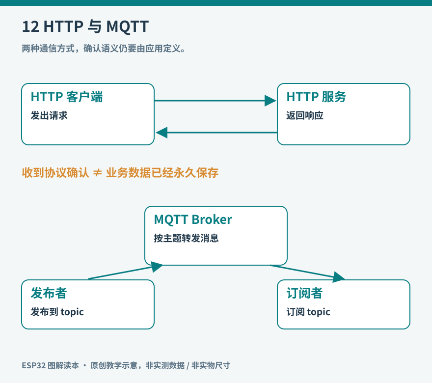

# 第12章 HTTP、MQTT与数据接口

一块板能访问服务器之后，还要决定双方怎样交换信息。HTTP 常用于“我提出请求，你给出响应”；MQTT 常用于“我发布到某个主题，订阅者收到消息”。它们都能传温度，却会形成不同的系统关系。



*图12：原创教学示意。箭头表示应用消息方向；底层连接、认证和错误处理同样需要设计。*

## HTTP：一次交换也有多种结果

HTTP 请求包含方法、目标、头字段和可选内容。读取状态常用 GET，提交一条记录可能用 POST；状态码说明这次请求的 HTTP 结果，响应内容再承载应用数据。[RFC 9110](https://www.rfc-editor.org/rfc/rfc9110.html)定义了这些语义，而不是规定你的温度记录必须采用哪个 URL。

例如设备向服务端提交一条环境记录，服务端可能返回成功、参数错误、身份失效或暂时不可用。只有收到 HTTP 200 并不一定能确认数据已持久化：要看你与服务端的接口约定。反过来，连接超时也不一定说明服务器没处理请求；请求可能已经抵达，只是响应在返回途中丢失。

这就是重试需要考虑“重复”的原因。若同一条 POST 每重试一次就在数据库新增一行，会出现重复记录。可以为每条记录加入稳定身份，例如设备 ID、启动会话 ID 和采样序号，由服务端去重。不要把重复采样混成一次重试，也不要把重试时刻当作采样时刻。

ESP-IDF 的 [`esp_http_client`](https://docs.espressif.com/projects/esp-idf/en/stable/esp32s3/api-reference/protocols/esp_http_client.html)提供 HTTP/S 客户端；其中阻塞调用会占用当前任务直到完成或失败。主循环中加入一个可能等待数秒的网络请求，按钮响应和屏幕更新也会跟着受影响。应明确超时，并根据系统复杂度把请求放到合适任务或事件处理过程中。

## MQTT：通过代理分发消息

MQTT 的发布者与订阅者通常都连接到消息代理，也称 broker。环境记录器发布到 `home/study/environment`，显示终端订阅这个主题；记录器不需要事先知道有几块屏幕在观看。主题是应用约定的名字，不是自动发现的设备目录。

可以把主题组织为设备和用途，例如：

- `lab/node-01/telemetry`：设备产生的测量数据。
- `lab/node-01/state`：设备实际状态。
- `lab/node-01/command`：发给设备的控制要求。

这样做的目的是区分方向和意义。访问控制还应限制每台设备能发布和订阅哪些主题；知道主题名并不意味着应当拥有权限。不同设备也需要不同的客户端身份，避免因为 ID 冲突而相互挤下线。

[OASIS MQTT 3.1.1 标准](https://docs.oasis-open.org/mqtt/mqtt/v3.1.1/os/mqtt-v3.1.1-os.html)定义了主题、订阅、保留消息和服务质量等行为。这里解释的是通用概念，不能据此假定任意 Arduino MQTT 库都支持全部版本和功能。

## QoS解决传递问题，不替你完成业务

| 等级 | 传递层面的含义 | 应用仍要考虑 |
| --- | --- | --- |
| QoS 0 | 尽力发送，可能丢失 | 后续样本能否自然替代丢失数据 |
| QoS 1 | 至少一次，可能重复 | 用记录ID或命令ID去重 |
| QoS 2 | 协议层恰好一次的交换机制 | 实际执行、持久化与故障恢复 |

设备收到“打开输出”的消息，并不证明实际负载已经开启；代理确认接收，也不代表订阅端完成了动作。需要时由设备另发一条状态或执行结果，写明对应命令 ID。对物理动作，尽量使用“设为开启”这样的目标状态，少使用“再切换一次”：相同切换命令重复执行两次，结果可能回到原位。

保留消息 retained message 可以让新订阅者获得某主题最近保留的一条值，适合发布当前状态。但保留的“执行一次动作”可能在设备重连时重新触发，因此不能不加区分地对命令启用。遗嘱消息可帮助代理在异常断连被识别后发布离线信息，却不是瞬时、无延迟的断电传感器。

Espressif 的 [ESP-MQTT 文档](https://docs.espressif.com/projects/esp-mqtt/en/latest/esp32/)列出传输方式、QoS、认证和遗嘱等能力，并区分直接发布与进入发送队列的接口。当前 ESP-IDF 版本可能通过组件管理器引入它；不要照搬旧教程假设 MQTT 永远内置于相同目录。[官方组件仓库](https://github.com/espressif/esp-mqtt)给出依赖声明与版本文档入口。

## 数据先约定语义，再选JSON

JSON 易于观察，但字段名不会自动表达单位和有效性。下面是本书的概念样本，数字仅为示例，不是真实测量：

```json
{
  "schema": 1,
  "device": "desk-01",
  "boot": "session-a",
  "seq": 42,
  "uptime_ms": 180000,
  "temperature_c": 25.3,
  "humidity_percent": 48.0,
  "valid": true
}
```

`uptime_ms` 是本次启动后的时间，不是 UTC 日期；`boot` 用来区分重启后重复的序号。若设备尚未完成校时，就不要编造一个看起来正确的公历时间。若数值无效，应发送明确的无效状态、空值或约定的错误对象，而不是伪装成 0 ℃。

接收端也要限制消息大小、检查字段类型和范围、忽略未知字段或按版本规则处理。不能因为输入来自“自己的设备”就省掉验证。传感器更换、固件升级或数据损坏，都可能暴露这些假设。

## 加密需要验证通信对象

HTTPS 和基于 TLS 的 MQTT 可以保护传输，但客户端还需验证服务器身份。若为了让样例运行而关闭证书验证，设备可能加密地连接到了错误对象。应配置合适的信任根、校准系统时间并核对主机名，具体方法参考 [ESP-TLS](https://docs.espressif.com/projects/esp-idf/en/stable/esp32/api-reference/protocols/esp_tls.html)。凭据也不应直接写进准备公开的源码或日志。

第一次实践可先搭建受控的本地服务：用电脑端工具确认接口可用，再让设备发送固定样本，最后接上真实传感器。依次测试错误凭据、断网、服务重启、重复消息与超长输入。你要观察的不只是“成功收到了什么”，还有失败能否被解释、恢复后是否重复执行了动作。

当 HTTP 的明确请求适合当前任务时，不必为了“物联网”三个字强加 MQTT；需要多个订阅者持续接收状态时，消息代理又可能降低耦合。协议选择要服务数据关系，而不是服务名词的流行程度。

## 做一张失败结果表

在发送数据前，把失败分成三类：请求尚未发出，已发送但结果未知，已收到明确拒绝。第一类通常可以稍后再试；第二类需要处理可能重复；第三类应根据错误调整参数、凭据或发送频率。把三类都当成“立刻重试”会制造无效流量，也可能使账号被限速。

缓存同样需要上限。每秒产生一条记录，网络离线数小时，就会积累数千条。先决定哪些记录必须保留：可按时间降采样、保留最近窗口，或写入足够可靠的本地存储；缓存满时要有可观察的计数。静默丢弃与毫无限制地占满内存，都不利于后续分析。

恢复联网后可以限速补传，避免历史数据与实时数据互相挤占。每条记录携带原始序号和采样时间，服务端按其实际含义整理；不要在补传时给旧数据统一盖上“现在”的时间。

接口还需要面对升级。一旦某版固件增加字段，旧接收端最好能按约定忽略不认识的可选字段；单位或含义改变则应使用新字段或新版本。把 `temperature` 从摄氏度悄悄改为华氏度，即使 JSON 仍然合法，也会让整个系统产生错误结论。

这些约定应写成短小的接口说明，至少列出主题或 URL、方向、字段、单位、有效性、最大长度与重复处理方式。它不需要很厚，却能使设备端、服务器和后来接手的人对同一条消息有相同理解。
