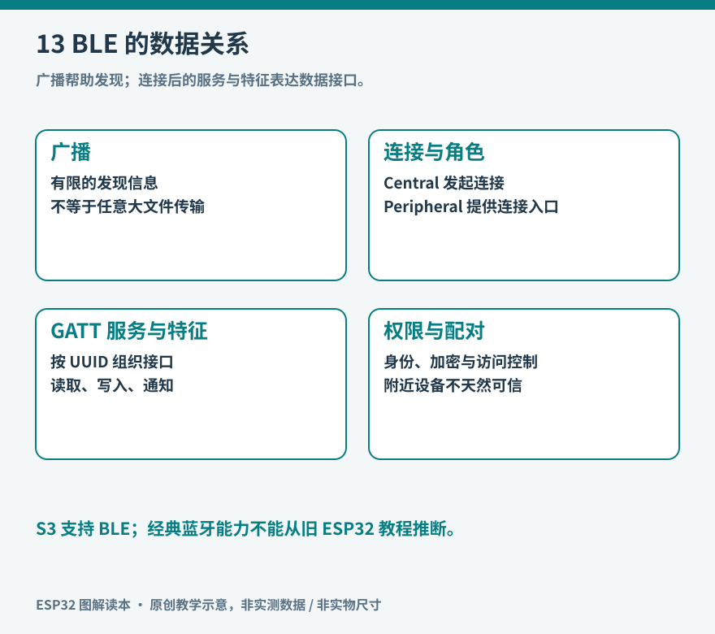

# 第13章　蓝牙与近距离连接

把一只温度记录器放在抽屉里，偶尔用手机靠近读取，未必需要先替它配置家里的 Wi-Fi。近距离连接的价值，在于把设备接入和使用过程缩短：发现附近的设备、辨认它、交换少量信息，然后断开。蓝牙低功耗技术常用于这一类场景，但“有蓝牙”并不意味着能播放所有蓝牙耳机支持的音频，也不意味着手机会把它当作串口。

## 同一个名字下的不同能力

Bluetooth Classic 与 Bluetooth Low Energy（BLE，蓝牙低功耗）是不同的技术体系。最初的 ESP32 支持经典蓝牙和 BLE，ESP32-S3 则只支持 BLE。把针对经典蓝牙串口协议 SPP 的 `BluetoothSerial` 示例搬到 S3，问题在于硬件和协议能力，不是换一个库名就能补齐。乐鑫在 S3 的蓝牙概述中明确区分了支持范围；选栈也应结合目标芯片，而不能仅看某个通用 API 页面的简介。[资料：ESP32-S3 BLE 概述](https://docs.espressif.com/projects/esp-idf/en/latest/esp32s3/api-guides/ble/overview.html)。

BLE 的低功耗来自工作安排：无线电可以间歇活动，用短暂的广播和连接事件交换数据，事件之间留出休息机会。如果一直扫描、频繁通知、大量计算并常亮屏幕，整机仍然可能很耗电。BLE 是一种有利于低功耗设计的工具，最终消耗还取决于应用和硬件。

*图13：广播用于让设备被发现；连接后通过服务和特征交换应用数据。图中概括发现、连接、数据与权限四个层面。*

## 广播像门牌，服务像目录

一台 BLE 外围设备可以周期性广播少量信息。手机作为中心设备进行扫描，看见设备后决定是否连接。这里的中心和外围角色描述连接行为，客户端和服务器则描述 GATT 数据访问行为；两组概念相关，但不能当作完全相同的称呼。

GATT 可以理解为一份有结构的数据目录。服务把相关功能归在一起，特征承载具体的值及其访问规则。例如环境记录器可以提供一个环境服务，里面有温度、湿度和电池状态三个特征。UUID 是用来辨认服务或特征的标识，名称字符串主要帮助人阅读，不能依靠名称完成严格身份校验。

读取是客户端主动询问当前值；写入是客户端向设备提交值；通知是客户端订阅后，服务器主动推送变化。通知与 indication 也有区别：后者在 ATT 层带确认，前者没有这种逐条确认机制。应用若不能容忍记录缺失，仍需设计序号和补取方式，不能只因底层建立了连接便假设数据永不遗漏。进一步的协议行为可从 [Bluetooth SIG 的 GATT 介绍](https://www.bluetooth.com/bluetooth-resources/intro-to-bluetooth-gap-gatt/) 入手。

一条温度记录不应只有 `24.6`。接收端至少要知道单位、记录序号和采样时间含义。可以先规定一个简单文本格式，例如 `seq=18,temp_c=24.6`；以后再改成更紧凑的二进制。格式版本与字节序应写入协议说明，否则双方“都发送了两个字节”仍可能得出不同数值。

## 做一次有边界的手机读取实验

实验采用本书的 S3 开发板，不依赖额外传感器，先发送一个明确标为模拟的计数值。选择与已安装框架版本一致的官方 BLE 服务示例，记录示例路径、板卡设置和库版本；不要同时安装几个同名蓝牙库，让编译器随机选中一份。ESP-IDF 提供 Bluedroid 与 NimBLE 两条开发路线，按项目内依赖选择一种，避免混合彼此的对象和回调。[资料：官方 BLE UART 服务示例](https://github.com/espressif/esp-idf/tree/master/examples/bluetooth/ble_uart_service)。

1. 让设备广播一个容易辨认的实验名称，同时在串口打印启动和连接事件。手机授予所需的蓝牙扫描权限后，使用 BLE 浏览工具扫描。
2. 连接设备，展开服务，找到示例指定的特征。先读取一次固定值，确认服务发现和读取链路成立。
3. 开启通知，每秒更新一次递增序号。连续观察二十条，检查序号是否连续，并记录收到第一条数据前的等待时间。
4. 关闭订阅，再观察设备是否停止发送无用通知。随后主动断开，检查设备是否恢复到可发现、可再次连接的状态。
5. 手机离开通信范围，再返回。程序应把掉线当作正常状态变化，而不是永久卡在“已经连接”的旧标记上。

这些步骤把问题拆成扫描、连接、服务发现、读取、订阅和恢复。若第一步就找不到设备，先确认程序确实运行、手机权限和广播状态；尚未发现设备时修改温度数据编码没有意义。

## 一条连接中的限制

无线包的有效应用载荷受协商结果和协议开销影响。ATT MTU 不应被简单等同于“一次能够可靠发送的任意长字符串”。长消息需要分片、长度边界和重组；接收端还要处理超时和断开后残留半条消息的问题。初学实验先使用短消息，避免让分包问题掩盖基本流程。

连接参数会影响延迟与能耗。手机操作系统参与协商，设备提出的间隔不一定就是最终采用值；后台运行策略也可能改变扫描和连接表现。观察结果应同时注明手机系统、前后台状态和距离，不能把某一次桌面实验的响应速度当作所有手机的保证。

ESP32-S3 的 Wi-Fi 与 BLE 使用同一芯片中的无线资源，应用不能据此想象成两套完全独立、永不争抢的收发器。需要两者同时工作时，先建立单独的功能基线，再加入并行上传，比较通知间隔和丢包情况。相关约束见 [乐鑫无线共存指南](https://docs.espressif.com/projects/esp-idf/en/stable/esp32s3/api-guides/coexist.html)。

## 靠近不等于可信

设备名称可被模仿，发现一个叫作“我的温度计”的广播不能证明它就是自己的设备。配对、绑定、加密、身份认证和应用授权是相互关联但不同的环节。允许手机读温度，与允许手机更改门锁状态，对身份确认的要求显然不同。

实验阶段可先保持一个只读的模拟值服务，理解连接过程；加入写入功能时，再规定谁能写、哪些值合法，以及修改后怎样反馈。回调中应先检查长度、范围和当前状态，把耗时工作移交给主循环或任务。让蓝牙回调直接执行长时间的电机动作，会使通信处理与物理行为难以协调。

蓝牙适合附近交互和少量数据交换。需要跨城市访问设备时，仍需要手机、网关或网络服务承担中转。理解这条边界，才能合理安排设备本身、手机和远端系统各自承担的职责。

## 怎样选择一条简单的应用协议

用手机改一个刷新间隔时，可以把写入值定义成“期望状态”，例如 `period_ms=2000`，设备检查后返回实际采用值。这比单纯发送“切换一次”容易恢复：前一条回复丢失时，手机重发同一个期望值，不会让设备意外切换第二次。对不能重复执行的动作，则需要命令编号、执行结果和重试规则。

读取当前状态与发出命令最好有清楚边界。手机写了一个数，不等于硬件已经完成动作；显示“已提交”“设备已接受”“已完成”中的哪一种，应由实际收到的反馈决定。例如电机的目标角度和实际到达状态就是两条信息。没有位置反馈时，只能报告已输出控制信号，不能宣称机构到位。

广播里也不宜放个人身份或敏感测量信息。广播便于附近设备发现，设计时应预期附近其他接收者也可能看到这些内容。先让广播承担发现作用，把需要授权的操作留在受控连接和应用校验中，会使协议更容易审查。
