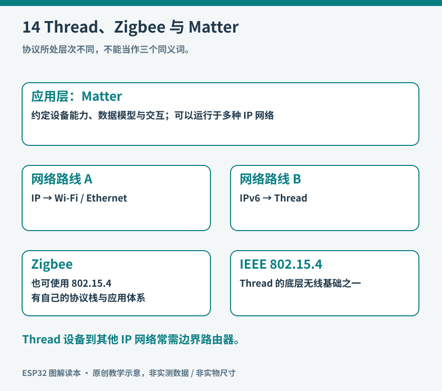

# 第14章　Thread、Zigbee与Matter

一盏灯标注“支持 Matter”，另一只传感器标注“Zigbee”，路由器说明中又出现 Thread。它们都与智能家居有关，却不在同一层解决问题。选购或设计时，如果只把这些名字看成几种可互换的无线方式，很容易遇到硬件已经买齐、设备却无法加入同一个系统的情况。

## 先分清无线链路与应用语言

IEEE 802.15.4 描述低速无线网络所用的一部分底层规则。Thread 在这一基础上提供适用于低功耗设备的 IPv6 网状网络；Zigbee 则有自己的网络和应用体系。两者可能使用相同类别的无线收发硬件，却不能因为频段相同就直接互相通信。就像两台设备共用一种电缆，并不意味着它们理解同一种消息。

Matter 主要解决智能设备的应用互操作和安全接入，可以运行在 Wi-Fi、Thread 或以太网等 IP 网络上。BLE 常用于发现和配网过程，不能由此推导“所有 Matter 业务都通过蓝牙传输”。Thread 本身也不限定应用一定是 Matter。[资料：Connectivity Standards Alliance 的 Matter 说明](https://csa-iot.org/all-solutions/matter/)；[Thread Group 的技术概览](https://www.threadgroup.org/What-is-Thread/Overview)。

*图14：Matter 位于应用层面，Thread 和 Wi-Fi 提供不同的 IP 网络路径；Zigbee 是另一套网络与应用体系，不能把三者画成同级替代项。*

为了说明关系，可以把房间内的灯具想成使用同一套照明词汇的设备。“调到百分之五十”属于应用语义，消息如何穿过房屋网络属于传输路径。Matter 统一其中一部分应用语义和设备行为，Thread 提供一种适合小型无线节点的网络路径；真实系统还包含身份凭据、控制器和设备类型支持。

## 哪些 ESP32 可以直接参与

本书的 S3 主实验板没有原生 IEEE 802.15.4 无线电。学习 GPIO、Wi-Fi 和 BLE 无须更换板卡，但学习原生 Thread 或 Zigbee 节点时应选择对应硬件。C6 集成 Wi-Fi、BLE 和 802.15.4；H2 集成 BLE 和 802.15.4，没有原生 Wi-Fi；P4 本身没有集成这些无线连接，常与外部无线芯片组合。这里列的是解释系统分工的代表型号，不是完整产品清单。具体模组、SDK 支持与并发组合必须单独核验。[资料：ESP32-C6 数据手册](https://documentation.espressif.com/esp32-c6_datasheet_en.html)、[ESP32-H2 产品说明](https://www.espressif.com/en/products/socs/esp32-h2)、[ESP32-P4 产品说明](https://www.espressif.com/en/products/socs/esp32-p4)。

| 要完成的事情 | 需要核对的能力 | 不能据此推导的结论 |
| --- | --- | --- |
| S3 作为 Matter over Wi-Fi 设备 | SDK、分区与设备类型支持 | S3 自带 Thread 无线电 |
| C6 作为 Thread 终端 | 802.15.4 与对应 Thread 软件 | 所有无线协议可任意同时满速运行 |
| H2 作为低功耗节点 | BLE、802.15.4 和外围电路 | H2 可以直接连接 Wi-Fi 路由器 |
| 多芯片构成边界路由器 | 主机、无线协处理器及软件组合 | 任意两块板接上串口就成为网关 |

## 网络中的角色比名称更重要

Thread 的网状网络允许具备路由能力的节点转发消息；睡眠终端依靠父节点维持接入关系，可以较长时间关闭无线电。并非所有小电池设备都会帮助邻居转发，也不能把增加一个睡眠传感器等同于增加一个扩大覆盖的路由节点。

Thread Border Router，通常译作边界路由器，让 Thread 网络与其他 IP 网络互通。Matter 控制器则负责配对、管理或控制 Matter 设备。两种功能可能装在同一台家居中枢中，但职责不同。一个能转发 Thread 数据包的盒子，不一定同时拥有家庭控制器所需的应用能力和授权。

乐鑫官方边界路由器方案中，可以由 S3 承担 Wi-Fi 主机，由 H2 作为 802.15.4 无线协处理器，二者通过规定的接口和固件配合。这是“擅长联网的主机＋特定无线电”的真实架构实例。[资料：ESP Thread Border Router 硬件平台](https://docs.espressif.com/projects/esp-thread-br/en/latest/hardware_platforms.html)。

Zigbee 中的协调器、路由器和终端是另一套角色。不能把一个 Zigbee 协调器直接称为 Thread 边界路由器。要把 Zigbee 设备纳入 Matter 家庭，需要桥接设备翻译并暴露对应功能，还要考虑桥接支持哪些设备类型和特性。

## 用一个虚拟开关理解接入过程

第一次实验不必接真实灯具。选用受 SDK 支持的 C6 或 H2 板卡，运行匹配硬件与版本的 Matter 灯或开关示例，用串口日志中的开关状态代表输出。如果走 Thread 路线，先确认已有兼容的 Thread 边界路由器，以及可用的 Matter 控制器；只有 Wi-Fi 路由器还不够。[资料：ESP-Matter 入门与支持路径](https://docs.espressif.com/projects/esp-matter/en/latest/esp32c6/introduction.html)。

依照示例生成或显示配网信息后，在控制器里添加设备。观察顺序应是发现、建立安全会话、提交网络配置、加入目标网络、完成设备注册，最后才是发送开关命令。每个阶段失败的含义不同，重复擦除固件不能代替辨认失败阶段。

接入成功后，先在家庭网络内切换虚拟开关，再暂时断开外网，观察本地控制是否仍工作。互联网中断、Wi-Fi 中断、Thread 网络断开是三种不同实验，应该分别记录；一次断网测试不能证明系统完全离线可用。随后让设备断电重启，确认凭据与设备身份能否按预期恢复。

最后执行一次官方定义的恢复出厂流程，再尝试重新加入。恢复出厂通常涉及清除网络或配对信息，与单纯复位不是同一件事；保留旧控制器记录也可能影响再次接入。实验记录应说明清除了哪一侧的状态。

## 互操作也有边界

支持 Matter 不等于所有平台都展示全部高级功能。设备类型、规范版本、控制器实现、地区配置和认证状态都可能影响实际可见能力。设计一只特殊传感器时，应先找到匹配的数据模型，而不是把任意 JSON 塞进标准字段就宣称通用兼容。

学习这些协议的重点，是理解家庭设备怎样形成一个可维护的系统：终端负责测量或动作，网络负责送达，控制器负责管理，边界路由器负责网络互通，桥接器负责跨体系映射。明确角色后，再决定增加无线节点、网关软件还是云端功能，才能避免用一个“万能网关”的名字掩盖缺失的实际工作。

## 网状网络也需要合适的位置

在一套小型实验网络中，先让节点与边界路由器位于同一房间，确认接入和控制成立，再逐渐增加距离或隔墙。信号弱、拥挤频段和节点角色变化可能同时影响结果。每次只改变一个因素，记录节点位置、供电方式和可见状态，才能判断新增路由节点是否改善了实际覆盖。

不要把网状拓扑画成每个节点都与所有邻居同时保持同样的关系。真实网络会选择路径，角色和链路也会变化；一个节点离线以后，恢复需要时间，具体表现由网络条件和实现决定。实验中让一个中间节点断电，观察终端是否恢复、恢复多久以及控制器怎样显示离线，比仅查看一张理想网图更能说明网络可靠性。

如果兴趣主要是自动化而非协议栈，可以先使用现有控制平台和官方设备示例，学习状态、自动化和故障恢复。只有需要开发自己的设备功能、桥接特殊协议或调整资源占用时，再逐步进入协议栈内部。这样既能获得完整系统经验，也避免让所有学习都停在配网排错上。
