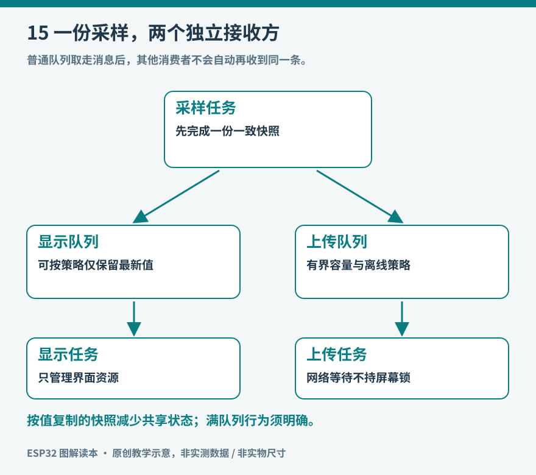

# 第15章　FreeRTOS与并发

环境终端每秒读一次传感器，屏幕要及时响应按钮，网络上传有时却要等待数秒。把这三件事顺序写在一个循环中，上传一慢，按钮和屏幕也跟着停顿。并发设计试图让不同工作在各自合适的时机推进；它的核心是安排等待、共享资源和信息传递。

## 任务不是更多的处理器

FreeRTOS 是用于嵌入式系统的实时操作系统内核。任务拥有各自的执行上下文和栈，调度器决定哪些就绪任务获得处理器。单核芯片也能交错推进多个任务，双核则可以在条件允许时同时执行。ESP-IDF 为 S3 等双核目标提供 SMP 支持；不能把所有 ESP32 系列都假定为双核，也不能以为增加任务会凭空增加计算能力。[资料：ESP-IDF FreeRTOS 说明](https://docs.espressif.com/projects/esp-idf/en/stable/esp32s3/api-reference/system/freertos_idf.html)。

“实时”关心工作能否在要求的时间内完成，不等于某项运算一定更快。一个高优先级任务不断忙等，反而可能让低优先级任务长期得不到运行。实时系统依赖清楚的截止时间、受控的执行时长和等待行为，不能靠把所有任务优先级都调高来获得。

*图15：采样完成后提交一份数据快照；显示和上传分别等待自己的输入。队列有容量，装满时必须有明确策略。*

## 从事件循环开始拆分

在使用多个任务之前，可以先把程序改成不长时间阻塞的状态机：读取当前时间，判断采样是否到期；检查是否有按钮事件；推进网络状态。每一步做少量工作，随后回到循环。许多小型程序采用这种方式已经足够，结构也容易理解。

当某项库调用不可避免地等待，或确实存在独立的持续工作时，再考虑拆成任务。例如把网络上传交给独立任务，采样任务只把数据交出去。拆分的依据是等待和职责边界，不是“每个函数都应该单开一个任务”。

任务常见状态包括运行、就绪和阻塞。等待队列消息时阻塞，表示暂时没有工作，处理器可以执行其他任务。反复读取一个标志直到它变化则是忙等，会持续占用执行机会。定时采样也应尽量等待到下一周期，而不是用空循环消耗时间。周期精度要求较高时，应阅读对应版本的延时和定时器 API，区分“本次结束后再等一秒”和“以固定节拍开始下一次”。

## 先定义一份数据的所有者

假设采样任务逐项更新全局变量：先写温度，再写湿度，最后写序号。显示任务可能恰好在中间读取，于是得到本次温度、上次湿度和旧序号。单个数值看上去都合理，组合却不属于任何一次真实测量。

一种更容易审查的做法，是先在采样任务的局部结构中完成整份记录，然后通过队列提交副本。消费者得到的是一致快照。若传递指针，则要额外规定缓冲区归谁、何时能复用以及谁负责释放；不能把一个即将离开作用域的局部对象地址交给其他任务。

`volatile` 主要限制编译器对特定访问的优化，不能自动使多个字段组成一个原子快照，也不能代替互斥锁、队列或完整的同步规则。多个任务访问同一个设备驱动时，还要核对驱动和库的线程安全条件。

## 队列满了以后怎么办

假设每秒产生一条测量，网络离线五分钟，容量只有十条的队列必然装满。这里没有一种同步原语能代替产品选择。

| 数据用途 | 队列满时的合理选择 | 代价 |
| --- | --- | --- |
| 当前温度显示 | 保留最新值，覆盖旧显示请求 | 不保留完整历史 |
| 每次按键计数 | 暂存或增加明确的丢失统计 | 需要更多存储或背压 |
| 历史环境记录 | 写入有界离线日志，恢复后补传 | 增加存储管理复杂度 |
| 过期的远程刷新请求 | 合并重复请求 | 每次请求不再独立执行 |

如果显示和上传都应收到同一条数据，不能只让它们竞争从同一个普通队列取出消息；一条消息通常只会被一个消费者取走。可以分别发送到两条队列，或让专门的分发者保存最新快照并通知各方。先画清楚数据流，再选 API，会比先堆任务容易得多。

## 锁保护资源，也可能制造等待

互斥锁用来保护不能同时使用的资源，例如共享总线上的某个库对象。持锁范围应短，只覆盖必要操作。不要持着屏幕锁等待网络响应，也不要让两个任务以相反顺序获取两把锁，否则可能产生死锁。

临界区适用于极短的共享状态操作，其使用方式与芯片和内核实现有关。它不能成为容纳文件写入、日志打印或任意库调用的“安全盒子”。在 SMP 系统中，仅仅停止一个核心上的中断，也不等于阻止另一个核心访问共享内存。对初学项目，优先把复杂设备操作交给单一所有者任务，其他任务发送请求，可以显著减少锁的数量。

中断服务程序也不是普通任务。它应尽快记录必要信息并退出，通常借助明确标注的 `FromISR` 接口唤醒后续处理；不能随意调用会阻塞的队列函数或复杂显示函数。具体可用接口与是否要求代码、数据驻留特定存储区，应按驱动文档核验。

## 一个可观察的并发实验

先让主循环每一百毫秒输出一个递增节拍，再在其中加入一个两秒的模拟等待，观察节拍出现长空隙。随后把模拟等待移入独立任务，通过队列提交“完成”消息；主循环继续处理节拍和按钮。模拟等待必须写明用途，不要把一个假的延时当成真实网络性能。

第二轮让生产者比消费者快，记录队列的满次数和保留策略。第三轮让网络任务失败重试，确认重试有间隔，按钮仍能工作。这三轮分别验证阻塞隔离、容量边界和异常路径，比看到两个任务交替打印更能说明结构是否合理。

最后记录任务数量、栈使用和最长响应时间。栈空间不足会造成难以解释的异常，分配过多又挤占堆内存；ESP-IDF 的栈参数和某些上游 FreeRTOS 示例的单位并不总相同，复制时必须查看目标版本定义。并发设计完成的标准，是信息归属、等待边界和失败行为都能解释清楚。

## 给响应时间建立一个预算

按钮按下到屏幕变化，可以拆成输入采集、消抖、消息排队、界面处理和显示传输五段。平均响应很快并不表示最慢情况也合格：上传时争用总线、队列里积压旧消息，都可能让少数操作等待很久。实验时记录最长观察延迟，并注明输入方式和负载条件。

若设计目标是一百毫秒内给出反馈，就要为这些阶段分配时间，避免其中某个环节允许无限等待。网络请求超时设为几秒并不必然影响按钮，前提是两者没有被同一把锁、同一任务或不可抢占的长操作绑在一起。

增加任务后还要重新检查关机和更新流程。准备进入深睡或执行固件更新时，应让任务停止接受新工作，完成或放弃队列中已有工作，保存必要状态，再进入下一阶段。直接在任意回调中切断所有活动，会使“并发正常运行”与“可靠退出”之间留下缺口。
