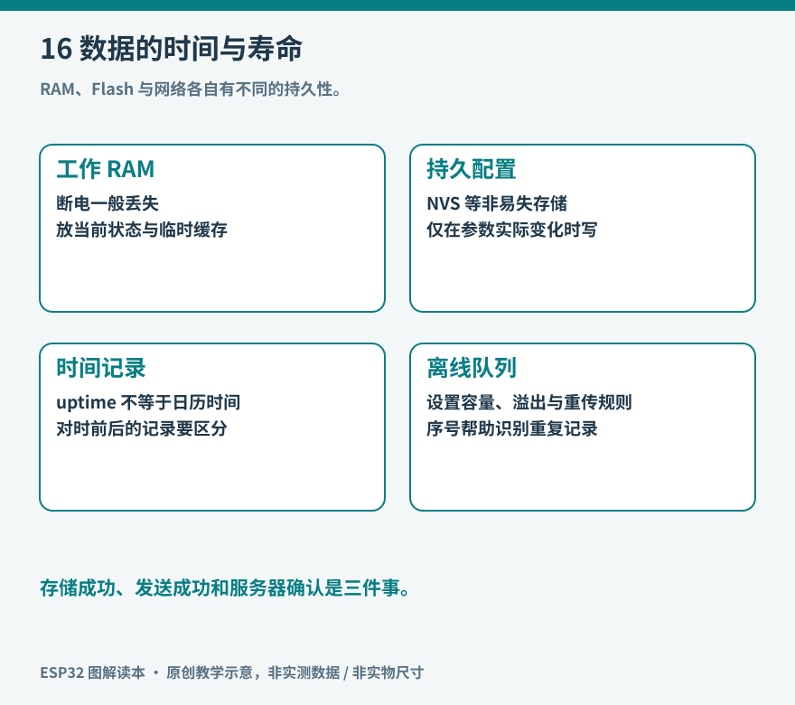

# 第16章　存储、时间与离线运行

设备能把温度上传一次，并不代表它已经成为记录器。断电后设置是否还在？网络中断时记录放在哪里？重启后的一条数据，怎样与上次的记录区分？存储和时间共同决定了一组数字能否成为可解释的历史。

## 不同存储承担不同职责

运行中的普通变量位于 RAM 中，适合临时状态和高速处理，断电后通常不再保留。Flash 能保存固件和数据，但写入与擦除有物理限制。PSRAM 扩展运行内存容量，不是断电保存介质；一块带大容量 PSRAM 的模组，并不因此拥有同样容量的永久日志空间。

NVS 是 ESP-IDF 的键值存储，适合设备名称、阈值、校准参数等小型配置；文件系统更适合连续记录和较大文件。Arduino-ESP32 的 Preferences 封装了常用 NVS 操作，可按命名空间保存键值。官方建议大量数据考虑文件系统，而不是把整本日志塞进一个配置键。[资料：Preferences API](https://docs.espressif.com/projects/arduino-esp32/en/latest/api/preferences.html)。

*图16：配置按变化写入，采样形成有界日志，上传确认后再推进补传位置。RAM 缓冲可以提高效率，但断电会丢失尚未持久化的数据。*

## 把一次配置修改写完整

以温度报警阈值为例，程序启动时先加载配置，缺失则使用明确的默认值。收到修改请求后检查数值是否有限、是否位于允许范围，再更新。配置值没有变化时无须反复保存；如果用户拖动滑块每秒产生几十次变化，可以先更新界面，待操作稳定后再持久化。

一个简单 Preferences 练习可以先保存阈值，重启后读回，再主动删除对应键以验证默认值路径。调用 `begin`、写入函数和读回时应检查返回值或预期长度；失败不能仍在屏幕显示“保存成功”。命名空间和键名也有长度约束，不能把任意长的网页参数名直接用作键。

多个字段一起组成一份配置时，逐个保存不等于应用层事务。例如先保存最低温度、再保存最高温度，中途掉电后可能得到新旧混合状态。可以把带版本号、长度和校验信息的一份结构作为整体记录，再设计有效标记或双份轮换；读取时验证约束，不通过则回退到上一次有效配置。NVS 的内部恢复能力不能自动替应用保证跨多个业务字段的一致性。[资料：NVS 的设计与限制](https://docs.espressif.com/projects/esp-idf/en/stable/esp32/api-reference/storage/nvs_flash.html)。

## 磨损均衡不能消除所有寿命问题

Flash 通常需要按块擦除，不能把它想象成每个字节都能无限次随意覆盖。NVS 自带磨损均衡机制，可以降低局部擦除压力，但仍不值得把每次主循环的计数都立刻写入。具体寿命应以所用 Flash 器件及工作条件为准，不能拿一个典型次数推算所有开发板的保证年限。

文件系统同样需要理解自己的断电和同步语义。追加到文件、刷新库缓冲、提交到底层介质，是不同层次。若设备要求掉电时最多丢失一分钟记录，就应按这个目标设计缓冲和提交周期，并在真实硬件上做断电实验。测试只用于自己的低压记录设备，先保留可恢复固件和数据备份。

记录空间要有上限。存满后可以删除最旧记录、停止采样或降低记录频率，但必须让使用者知道发生了什么。每条记录除数值外，宜包含格式版本、设备或启动标识、单调序号、时间有效性和质量标记；校验可帮助识别意外损坏，却不能替代针对恶意修改的认证机制。

## 两种时间回答两个问题

墙上时钟回答“这是哪一天几点”，单调计时回答“距离刚才过了多久”。按钮消抖、超时和任务周期应使用适合测量间隔的计时来源；把网络校时后的日历时间直接用于超时，时间向前或向后调整时可能出现异常。

ESP32-S3 的系统时间可以由 RTC 定时器和高分辨率定时器组合维护；睡眠、复位和彻底断电的保留行为不同。内部低频时钟还会受温度等因素影响。应根据时钟来源与应用精度要求解释漂移，不能因为设备内部有 RTC 这个名字，就把它当成带独立电池的高精度日历钟。[资料：ESP32-S3 系统时间](https://docs.espressif.com/projects/esp-idf/en/stable/esp32s3/api-reference/system/system_time.html)。

联网后可通过 SNTP 获取日历时间。记录格式中应保留“尚未校时”的状态：设备刚启动时，不能把某个默认日期伪装成真实采样时刻。可以先记录本次启动内的相对时间，校时后建立对应关系；若期间经历断电或时钟不连续，就应保留不确定性，而不是随意补出精确时间。

## 断网后怎样补传

离线记录器需要明确的持久化边界和确认边界。假设记录号 101 已保存，设备上传后收到了服务器确认，但还没有保存本地确认位置就掉电。重启后它可能再次上传 101。与其假定重复永不发生，不如让服务器用设备标识和记录序号识别重复，重复提交不产生第二份业务记录。这称为幂等处理。

上传成功必须来自协议和业务认可的确认，不能仅以“已调用发送函数”判断。只有确认有效后，才能推进本地补传位置或释放记录。补传也要限速，避免网络恢复后连续上传把采样和界面都拖慢。

可按四轮验证设计：正常联网保存十条；断网继续保存十条；恢复网络补传；最后在补传过程中重启。检查总记录数、序号是否重复、缺口是否可解释，以及设备是否还能采样。这里的目标不是声称绝对不丢数据，而是让每一种丢失、重复和时间不确定性都可观察。

一套成熟的存储设计，通常不依赖“永远不断电”的前提。它承认系统会在任意阶段停下，并让下一次启动能够辨认此前完成了哪些步骤。这种思想从小型环境记录器一直延伸到数据库、消息系统和远程设备管理。

## 为一次记录估算空间

假设每条二进制记录占三十二字节，每分钟保存一次，一天仅记录载荷约为四十六千字节；真实文件还包含索引、校验、对齐和文件系统开销。若改用带重复字段名的文本格式，空间会增加，但排查和人工阅读更方便。格式选择应结合可用空间和调试需求，而不是只追求最短。

保留三十天历史，既要算平均写入量，也要给异常重试、文件管理和固件更新留下余量。Flash 容量并不全部属于日志，分区表已经把它分给引导信息、应用槽、配置和文件系统。扩大一个分区可能压缩其他功能，应先确认完整布局。

导出记录时同时导出单位、格式版本和时间说明。只有一列没有表头的数字，离开设备很快就会失去意义。记录器的任务因此包括保存数据的解释条件；温度校准参数改变后，至少应能区分前后两批记录采用了哪种配置。
