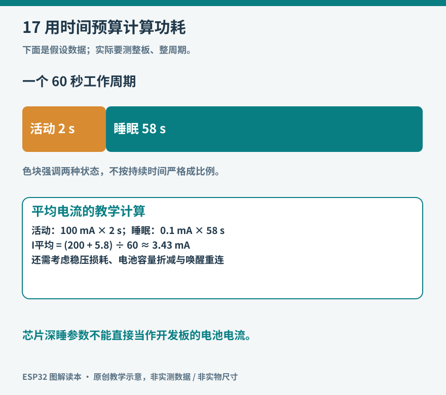

# 第17章　电池、睡眠与功耗预算

一只 USB 供电的温度终端连续工作几天并不困难，换成小电池后却可能很快停机。问题往往不是芯片“不够省电”，而是无线连接、屏幕、稳压器和开发板上的附属电路一直在消耗能量。低功耗设计需要计算完整工作周期，再测量整机。

## 先画出一天怎样度过

设备的能耗来自各阶段电流与持续时间。对供电电压近似稳定的同一条电源轨，可以先用平均电流估算：把每个阶段的电流乘以该阶段时间，求和后除以总时间。当阶段之间电压不同或涉及转换效率时，应进一步用能量比较，而不是直接把不同电压下的毫安时相加。

假设一个纯教学模型每分钟工作两秒，工作电流 100 mA；其余五十八秒睡眠电流 0.1 mA，则平均电流约为 `(100×2＋0.1×58)÷60＝3.43 mA`。名义容量 1000 mAh 除以它，得到约 291 小时。这只是解释计算方法的理想上限，未计电池可用容量、温度、自放电、电源转换和截止电压，不能当作某块开发板的实测续航。



*图17：短暂高电流与长时间低电流共同决定平均消耗；还要检查瞬时峰值能否由电源承担。图中阶段长度为教学示意。*

从这个模型还能看出：如果睡眠期间多出一只持续耗电的指示灯，长时间积累的消耗可能超过优化几毫秒采样带来的收益。因此应先找最大的时间与电流乘积，再决定优化哪里。

## 睡眠深度决定保留什么

Light-sleep 使许多数字电路暂停或降低活动，唤醒后可以恢复继续执行；Deep-sleep 关闭更多电路，普通运行内存和程序执行上下文不能按原样继续，唤醒一般经过启动流程。S3 的具体保留电源域、RTC 内存和唤醒源都有明确条件，应以目标版本睡眠文档为准。[资料：ESP32-S3 睡眠模式](https://docs.espressif.com/projects/esp-idf/en/stable/esp32s3/api-reference/system/sleep_modes.html)。

深睡适合间歇测量，未必适合需要随时立即响应网络命令的终端。设备关闭无线电以后，服务器不能指望通过原连接随时叫醒它。若每次唤醒都重新关联 Wi-Fi、校时和建立安全连接，时间与能耗也必须算进工作阶段。

自动省电、Modem-sleep、Light-sleep 和 Deep-sleep 的连接行为不能混为一谈。程序主动调用睡眠 API，与框架配合无线协议执行自动低功耗，前提和效果可能不同。先确认应用要保留什么连接，再选择方案。[资料：乐鑫系统低功耗说明](https://docs.espressif.com/projects/esp-idf/en/stable/esp32s3/api-guides/low-power-mode/low-power-mode-soc.html)。

## 一个只验证定时唤醒的程序

下面是 Arduino-ESP32 环境中的最小教学草图，使用 ESP-IDF 的睡眠接口。它不包含传感器和网络，用于观察 S3 定时唤醒；尚未在本书实物上执行，不把串口输出当作整机功耗测量。

```cpp
#include <Arduino.h>
#include "esp_sleep.h"

void setup() {
  Serial.begin(115200);
  delay(300);  // 仅给本次串口观察留时间，也会增加能耗
  Serial.println("awake: next wake in 30 seconds");
  Serial.flush();
  esp_sleep_enable_timer_wakeup(30ULL * 1000000ULL);
  esp_deep_sleep_start();
}
void loop() {}
```

原生 USB 串口可能随深睡断开并重新枚举，观察端未必保留同一个连接。若看不见唤醒日志，先考虑串口路径和等待时间，不能立即判断芯片没有醒来。使用不同串口实现时，还应核对 `flush` 的实际语义。

下一步才加入采样，并使未使用的外设进入明确状态。用 GPIO 控制传感器供电不是通用做法：电流能力、启动浪涌、信号脚反向供电和上电时序都要检查。更可靠的电源开关通常需要合适器件和电路设计。

## 芯片睡着，开发板可能还醒着

开发板包含 USB 转串口器、电源指示灯、稳压器，以及可能存在的屏幕、充电器和电平转换器。芯片数据手册中的深睡电流，测量边界通常与 USB 口输入的整板电流不同。两者不能直接比较，更不能用其中一个代替整机测试。

先测裸开发板的基线，再接传感器，最后接屏幕和驱动板。每增加一个模块就记录变化，可以判断静态漏电来自哪一段。电池项目还应注意 USB 与电池同时接入时的供电路径，未经原理图确认不能随意并联两路电源。

低功耗测量也会反过来影响设备。万用表串入电流档后引入的压降，可能使无线发射时复位；低量程又可能无法承受峰值。第一次测量先从合适的大量程开始，确认连接和仪表规格。观察微安睡眠与毫安峰值跨度较大的设备时，功耗分析仪或带合适分流电阻的示波测量更有帮助。

## 电池容量之外还有峰值能力

电池标注的容量说明可释放电荷的一部分信息，不直接说明它能否稳定提供无线发射或电机启动所需的瞬时电流。内阻、电源转换器能力、导线和接点都会使电压下跌。平均电流很低的设备，仍可能在每次唤醒时因峰值而复位。

单节锂电池的充满电压高于 ESP32 的 3.3 V 供电轨，不能直接接到 3V3 引脚。应使用有正确稳压、充电和保护设计的供电方案，并阅读板卡对电池接口的定义。初学者可先在 USB 供电下测工作周期，理解预算后再换成明确支持电池的硬件。

续航验证应至少包含正常周期、弱信号重连和服务器不可达三个条件。弱信号下反复连接可能显著延长工作阶段；无限重试会让原本只应醒两秒的设备一直保持活动。给连接和上传设置总时间预算，失败后保存记录并等待下一周期，通常比单次追求“必须立刻传成功”更符合电池设备的目标。

低功耗不是一个函数，而是一整套有边界的运行安排：需要醒时醒、没有工作时休息、失败时及时退出，并让供电系统能够承受每一次必要的活动。

## 从测量结果倒推改进顺序

把整机电流随时间的曲线与日志事件对照，可以分辨高峰来自启动、无线关联还是上传。若采样只用很短时间，反复连接占据大多数能量，就应比较减少上传频率、合并多条记录和改善信号条件，而不是先重写传感器读取函数。

屏幕也应按使用场景设计。无人观看时常亮背光，可能比 CPU 的许多小优化更耗电；降低刷新频率只能减少部分开销，不必然关闭背光。电子纸在静态显示时有不同的能耗特点，但刷新速度、低温行为和所用模块待机电流仍需检查，不能只看显示技术名称推算整机续航。

最终验证应使用实际电池和外壳。外壳影响无线信号与温度，线材和接插件影响压降；台式电源下稳定的程序，装进成品后可能改变工作阶段长度。把这些变化纳入最后一轮测量，才能让预算从纸面模型接近实际设备。
