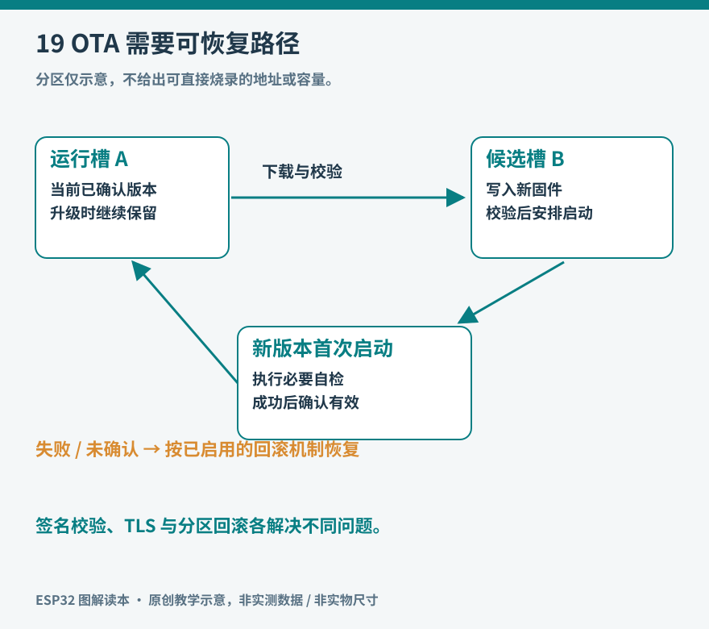

# 第 19 章 安全、配网与 OTA

一块只在桌上接 USB 的实验板，连接关系很容易看清；把它放到家中无线网络，允许手机修改参数，再让它自行下载新程序，设备就多了几种入口。安全设计的起点，是画清谁可以通过哪个入口改变什么，而不是先寻找一个叫作“加密”的开关。

本章沿着一台环境记录器的使用过程，讨论首次配网、日常联网、固件更新和转交他人。不同项目承担的后果不同，温度显示器和控制机械运动的设备不能共用一套“出错后继续运行”的策略。

图 19-1：候选固件写入备用槽，首次启动后自检并确认；回滚只有在正确配置与适用条件下才起作用。

## 从密码写在代码里开始改进

为了第一次连通，示例常把无线网络名和密码写成常量。这方便实验，但若把源文件提交到公开仓库，密码也随之公开；删掉最新文件不一定清除历史提交。实际工程应把个人配置留在不提交的本地文件中，发布模板只保留字段名称。共享串口日志时也不输出密码、完整令牌或私钥。

设备要长期使用，还需要允许用户换路由器。可以通过 USB 串口输入，也可以在按钮长按后进入限时配网模式。后者应有清楚的灯光或屏幕提示，成功后退出；不应在每次短暂断网时自动开放长期存在的配置入口。否则一次普通网络故障，就可能改变设备的可访问范围。

ESP-IDF 的统一配网框架支持 SoftAP 与 Bluetooth LE 等传输方式，并提供相应安全方案。传输方式决定手机如何连接，应用层认证则决定谁能提交配置，两者要分别选择。厂商文档中的设备持有证明 PoP，是让配置者证明自己掌握设备专属信息的一种方式。[资料：Espressif，Unified Provisioning](https://docs.espressif.com/projects/esp-idf/en/stable/esp32s3/api-reference/provisioning/provisioning.html)

在自己的样机上，可以用一个简单操作检查设计是否完整：保持设备供电，把路由器关掉再打开。设备应尝试重连，界面应显示连接状态；只有使用明确的本地操作，才进入配网流程。再检查恢复出厂设置是否会清除用户配置，同时保留恢复和刷机办法。

## 设备凭什么相信服务器

HTTP 能传输内容，却不自动证明对方是预期的服务器。HTTPS 在 HTTP 外提供 TLS 保护；正确使用时需要校验服务器证书，不能为了消除报错就长期关闭验证。设备时间错误、证书过期和信任链不完整都可能使校验失败，这些应成为可诊断的错误，而不是静默改用不校验连接。

对一台只上传温度的设备，可以给它限定为“向自己的数据主题写入”的权限，不授予管理所有用户、修改所有设备或执行任意命令的权限。某台设备遗失时，服务端可以撤销它的凭据，而不必更换整个系统的公共密码。这是权限范围和设备身份的设计，无法仅靠无线网络密码代替。

下载数据后也要检查结构。状态字段应来自允许的集合，数值应有合理范围，字符串应有限制长度。服务器返回 HTML 错误页、代理添加认证页面，或者接口升级增加字段，都不能直接变成屏幕乱码或执行参数。把网络输入视为“需要验证的数据”，会自然地得到更清楚的错误处理流程。

## 更新程序为什么要留另一份位置

OTA，即运行中的设备接收固件并更新自身。直接覆盖正在使用的唯一程序空间，容易在断电时失去可启动的版本。ESP-IDF 的普通应用 OTA 使用两个应用槽位及 OTA 数据分区：新镜像先写入未运行的槽位，完成校验后再切换下次启动目标。应用更新与引导程序、分区表更新的风险不同，不能把它们混为一种操作。[资料：Espressif，OTA Process Overview](https://docs.espressif.com/projects/esp-idf/en/stable/esp32s3/api-reference/system/ota.html)

更新的完整过程包含准备、下载、校验、试运行、确认。准备阶段先确认芯片目标、固件大小、分区空间和供电条件。下载失败保留旧程序，不能把失败当作更新完成。镜像能启动也只是第一步：假如新程序启动后一直重启，设备仍然不能工作。

启用并正确配置应用回滚后，新版本需要在自检成功时确认有效。自检应检查设备自身能否稳定运行，而不是要求某个云服务此刻必须在线，否则服务短暂维护就会触发不必要回滚。恢复能力也有边界：旧固件若无法读取新版本写入的数据格式，回到旧槽位仍可能无法正常工作。因此配置迁移应保留版本号，并尽量允许前一版读取或恢复旧数据。

更新流程可以先在一块可通过 USB 恢复的实验板上验证：安装版本 A；更新为只改变屏幕版本号的 B；再制作一个自检失败的测试版本。观察每次启动日志中的版本与回滚原因。没有观察到恢复过程，就不能仅凭“下载进度到 100%”认定升级机制可靠。

## 三种保护不能互相顶替

| 机制 | 主要保护对象 | 仍需另外处理的事 |
| --- | --- | --- |
| TLS | 传输途中的通信与服务器身份校验 | 固件来源、设备本地权限 |
| Secure Boot | 启动时验证程序是否经过授权签名 | 已运行程序自身的逻辑缺陷 |
| Flash Encryption | 外部闪存内容的机密性 | 通信授权、应用输入检查 |

Secure Boot 在信任链中验证引导程序和应用签名；固件签名私钥应保存在发布方，设备只持有验证所需信息。[资料：Espressif，Secure Boot v2](https://docs.espressif.com/projects/esp-idf/en/stable/esp32s3/security/secure-boot-v2.html) Flash Encryption 则针对外部 Flash 读取；NVS 等数据的保护还需按实际分区和加密配置单独检查，不能从功能名称推断所有数据均已加密。[资料：Espressif，Flash Encryption](https://docs.espressif.com/projects/esp-idf/en/stable/esp32s3/security/flash-encryption.html)

这些功能可能涉及 eFuse 和下载、调试权限的持久变化。入门阶段先理解、阅读目标芯片对应文档，并在专门测试板上演练完整恢复路径，不把量产安全配置命令当作普通例程复制。真正上线时还要管理签名密钥备份、撤销、固件发布记录与凭据更换。安全不是最后一遍编译时附加的选项，它贯穿设备从第一次配置到退役的全过程。
