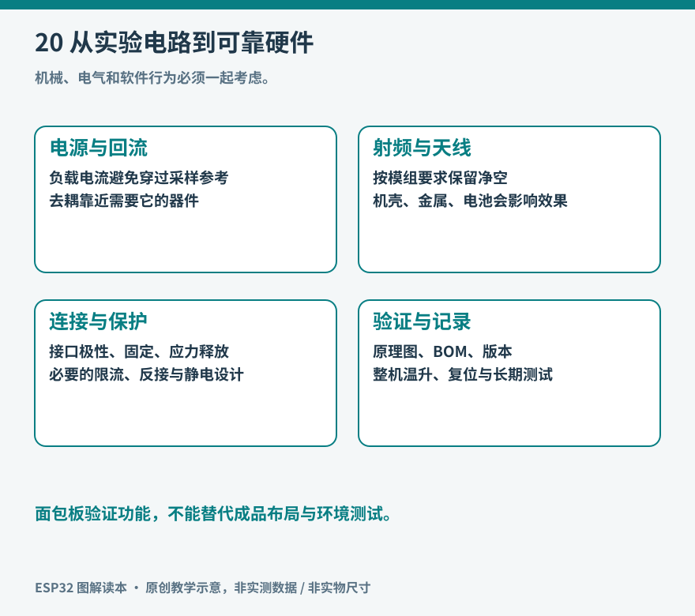

# 第 20 章 从面包板到可靠硬件

把杜邦线稍微移动，屏幕就恢复显示；换一根 USB 线，Wi-Fi 重连造成的复位就消失。这类经历说明，程序正确只是系统正常工作的一部分。面包板适合快速改变连接，长时间使用的设备还需要稳定供电、可靠连接、可维护结构和可重复的检查方法。

从样机走向成品，并不一定要立即设计裸芯片电路。把经过验证的开发板固定在载板上，使用可靠连接器和合适外壳，已经能完成很多个人项目。采用现成射频模组，则可以在尺寸、成本与设计难度之间取得另一种平衡。

图 20-1：从“桌面上能运行”到“重新装配后仍能运行”，需要逐步消除偶然条件。

## 先固定已经知道正确的部分

搬离面包板之前，先保存原理图、引脚表、照片、固件版本和一份成功日志。照片能帮助还原线缆走向，但不能代替原理图，因为照片往往看不出同一电源轨是否中断、连接器背面的实际顺序或模块内部上拉电阻。

画原理图时，把连接按电源、数字信号、模拟信号和机械接口分组。每根跨板连接都写清电压、信号方向、连接器编号及第 1 脚。电源线上标注允许电压，避免数月后把 12 V 电源插进 5 V 接口。若两种插头外形完全相同，仅靠颜色区分并不可靠。

完成记录后，先让原样机执行一组固定动作：上电、传感器读数、显示更新、网络连接、断网恢复、关机重启。新载板也执行同一组动作。只有使用相同条件，才能判断迁移是否引入问题；边换硬件边重写通信协议，会让故障来源变得模糊。

## 供电需要看瞬间，也需要看回路

电源的标称电流足够，并不保证板上电压始终合适。长线和接插件存在电阻，负载电流变化时会带来压降；无线发射、屏幕背光和电机启动又会在不同时间改变负载。数字万用表可能只显示平均值，示波器更适合观察短暂跌落与纹波。

布局时，电机的电流应通过明确的供电和回流路径返回电源，不从传感器附近细长的地线绕行。去耦电容应靠近被供电器件，而不是仅在电源入口放一只大电容。电容不是不受限制的“补丁”：容量、封装、稳压器稳定性和插入浪涌都需要配合。先找清楚电流回路，再决定哪里需要储能或滤波。

ESP32-S3 的官方硬件设计指南分别讨论电源、复位、时钟、Flash/PSRAM 与接口；裸芯片设计需要逐项核对，而不是只复制一个网上原理图。[资料：Espressif，ESP32-S3 Hardware Design Guidelines](https://docs.espressif.com/projects/esp-hardware-design-guidelines/en/latest/esp32s3/)

## 模组天线也是电路的一部分

带 PCB 天线的模组虽然容易焊接，天线附近仍需要按模组文档保留净空。铜皮、走线、电池、金属螺钉和外壳都可能改变射频表现。“板子在桌上信号很好”不能证明装进盒子后仍然如此。尤其不要把模组天线贴在金属面板上，再试图用提高软件重试次数弥补。

先按具体模组的推荐位置与净空尺寸布置，再用实际外壳、实际线缆进行对照。可以记录固定地点的连接稳定性、重连耗时和数据丢失情况；RSSI 只是其中一项指标。需要外接天线时，还要确认模组接口、天线规格和适用合规条件，不把更大天线简单等同于更可靠。[资料：Espressif，PCB Layout Design，含模组布局要求](https://docs.espressif.com/projects/esp-hardware-design-guidelines/en/latest/esp32s3/pcb-layout-design.html)

## 连接器与外壳决定设备如何被使用

日常插拔的线缆不应把拉力直接传到焊盘。可使用固定孔、线夹和应力释放结构，让外壳承担拉力。屏幕开窗要保留装配公差，按钮应能够正常按下却不被面板持续压住。温湿度传感器需要接触代表性的空气，不能紧靠稳压器、处理器或风扇电机的热源。

外壳还会影响散热和进气。为传感器开孔与防尘、防水之间存在取舍；“有一个防水外壳”不意味着装配后的整机具备任何特定防护等级。个人桌面设备可以先明确使用环境，例如室内干燥、USB 供电、避免凝露，再为这些条件设计，而不必把未经测试的性能写成产品承诺。

维护入口应和正常操作入口一样认真安排。保留可触达的 USB 或下载测试点、复位方式和版本标识，能让故障设备不必被完全拆解。记录连接器朝向和线束编号，也能显著降低重新装配时的接反概率。

## 做一份小而有效的验证表

| 检查 | 操作 | 应记录的证据 |
| --- | --- | --- |
| 无电检查 | 检查极性、短路、焊桥和连接器顺序 | 实物照片、连续性检查结果 |
| 分阶段供电 | 先主板，再逐个增加外设 | 各电源轨电压、静态电流 |
| 功能复现 | 执行原样机的固定操作 | 日志、读数、版本号 |
| 故障恢复 | 断网、拔掉可拔传感器后再恢复 | 错误提示、恢复耗时 |
| 装壳复测 | 完整装配后重复操作 | 温升、无线稳定性、按钮手感 |

首次上电可使用具有限流功能的低压电源，先设适合样机的保守电流限制；若电压被拉低或电流异常，不要反复加大限制，而应断电定位。检查通过后再连接更多模块，避免一个接反的外设掩盖主板是否正常。

一份有效的测试表应描述条件和结果，例如“路由器恢复后在规定时间内重新取得数据”，而不是写“网络没问题”。同样，不需要为了普通兴趣项目建立庞大流程；只要每次修改能复现主要功能，并知道失败时怎样回到上一个可靠版本，工程就已经比单次成功的演示更进一步。

从面包板到可靠硬件，核心变化是证据逐渐替代运气：电源有测量，连线有定义，功能有版本，故障有恢复办法。尺寸缩小和外观整洁应建立在这些基础之上。
