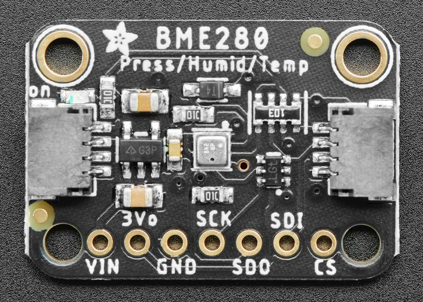
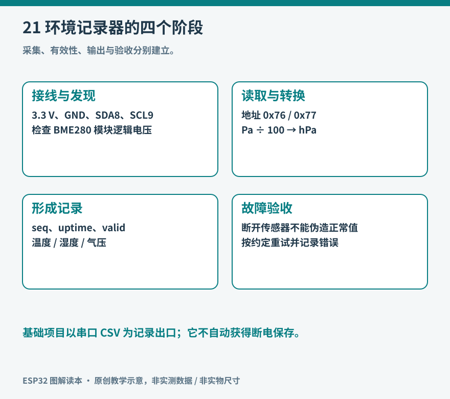

# 第 21 章 项目一：环境记录器

环境记录器把传感器读数变成一段有来历的数据。它既要知道测到了什么，也要知道何时读取、读取是否成功，以及传感器放在哪里。本项目先做 USB 供电、串口输出的版本，让电脑保存 CSV；确认读数可信后，再增加本地存储或联网，不一次引入所有部件。

项目采用 ESP32-S3-DevKitC-1 和 BME280 温湿度气压模块。BME280 与名称相近的 BMP280 不同，后者不提供湿度测量。购买与接线前应核对芯片型号、模块引脚定义和原理图，不能只根据商品标题判断。[资料：Bosch Sensortec，BME280 产品页与数据手册](https://www.bosch-sensortec.com/en/products/environmental-sensors/humidity-sensors-bme280)



*实物参照：先用这张近照认识模块，再使用本章连接表；照片展示的是一种六排孔加便捷连接器的版本。 图片：Kattni Rembor / Adafruit，[来源](https://learn.adafruit.com/assets/97115)，[CC BY-SA 3.0](https://creativecommons.org/licenses/by-sa/3.0/)；仅调整尺寸与文件格式。*

实物上的 `VIN/GND/SCK/SDI` 与本章表格里的“电源/地/SCL/SDA”对应阅读。读者手里的四针模块可能直接印 `VCC/GND/SCL/SDA`，排孔顺序仍需独立核对。将传感器放在与主板分开的短线上，能够比直接贴住稳压器更清楚地区分室温与板上发热。




图 21-1：项目的第一版只有测量和记录两条主线。屏幕与无线网络可以在数据链路稳定后加入。

## 材料、接线与摆放

| 材料 | 数量 | 本项目条件 |
| --- | --- | --- |
| ESP32-S3-DevKitC-1 | 1 | 具有可用 USB 下载和串口通道 |
| BME280 模块 | 1 | 明确支持 3.3 V 供电和逻辑电平 |
| USB 数据线、面包板、短跳线 | 各适量 | 数据线须能传输数据 |
| 电脑 | 1 | 安装 Arduino IDE 与 Arduino-ESP32 3.x |

断电后按下表连接。这里的 8、9 是 GPIO 编号，不是排针的第八、第九脚。S3-DevKitC-1 的板卡文档列出了这些 GPIO；其他板型要重新核对。[资料：Espressif，S3-DevKitC-1 v1.1 用户指南](https://docs.espressif.com/projects/esp-dev-kits/en/latest/esp32s3/esp32-s3-devkitc-1/user_guide_v1.1.html)

| ESP32-S3 | BME280 模块 | 说明 |
| --- | --- | --- |
| 3V3 | VCC 或支持 3.3 V 输入的 VIN | 按模块定义确认，裸芯片不接 5 V |
| GND | GND | 共地 |
| GPIO8 | SDA，部分模块写作 SDI | I2C 数据 |
| GPIO9 | SCL，部分模块写作 SCK | I2C 时钟 |

六脚模块可能还需设置 CSB、SDO 才能固定 I2C 模式和地址；四脚模块通常已经处理。I2C 上拉应接 3.3 V，先检查模块是否自带上拉，不盲目叠加。BME280 的可选地址是 0x76 或 0x77，具体由地址脚决定；扫描到地址只证明设备应答，不证明它就是期望芯片。模块接法和库安装可对照模块厂商教程。[资料：Adafruit，BME280 Arduino Test](https://learn.adafruit.com/adafruit-bme280-humidity-barometric-pressure-temperature-sensor-breakout/arduino-test)

把传感器与开发板隔开数厘米，远离稳压器和电脑出风口。气温比较要放在同一环境并等待稳定；刚从手中放下的传感器通常还带着手的热量。不要向器件吹湿气或滴水来测试湿度，普通环境传感模块不等于防凝露探头。

## 第一阶段：确认设备与单位

在 Arduino 库管理器安装 Adafruit BME280 Library，并接受其依赖安装。选择实际 S3 板型，按第 4 章确认串口通道。先运行库的 BME280 示例，必要时把初始化地址改成扫描得到的值，明确设置 `Wire.begin(8, 9)`。

成功标准不是出现任意数字，而是三项读数都有效，芯片识别正确，连续读取不会周期性失败。温度使用摄氏度，相对湿度使用 %RH，气压常见库输出单位为 Pa。本项目将气压除以 100 转为 hPa，字段名称也写成 `pressure_hpa`，避免数值看似大一百倍却无人发现。

相对湿度随温度变化，因此同一空气升温时，%RH 可以下降。气压反映测量位置的大气压力，不能未经海拔修正就与天气服务的海平面气压直接比较。本项目记录测站气压，不输出看似精确的海拔值。

## 第二阶段：按固定节奏输出 CSV

以下草图适用于本章接线及 Arduino-ESP32 3.x，依赖 Adafruit BME280 Library。它是完整的教学草图，尚未在本环境中完成目标工具链编译或实物验证。首次运行应先核对接线和库版本，串口选择 115200。每两秒输出一行，先关闭监视器的时间戳装饰，便于保存纯 CSV。

```cpp
#include <Arduino.h>
#include <Wire.h>
#include <Adafruit_BME280.h>
#include <math.h>

Adafruit_BME280 sensor;
bool sensorReady = false;
uint8_t sensorAddress = 0x76;

bool sensorResponds() {
  Wire.beginTransmission(sensorAddress);
  Wire.write(0xD0);  // BME280 chip-ID register
  if (Wire.endTransmission(false) != 0) return false;
  if (Wire.requestFrom(sensorAddress, (uint8_t)1) != 1) return false;
  return Wire.read() == 0x60;
}
uint32_t lastSample = 0;
uint32_t sequenceNumber = 0;

void setup() {
  Serial.begin(115200);
  delay(500);
  Wire.begin(8, 9);
  sensorReady = sensor.begin(0x76, &Wire);
  if (!sensorReady) {
    sensorAddress = 0x77;
    sensorReady = sensor.begin(sensorAddress, &Wire);
  }
  Serial.println("seq,uptime_ms,valid,temp_c,rh_pct,pressure_hpa");
}

void loop() {
  uint32_t now = millis();
  if ((uint32_t)(now - lastSample) < 2000) return;
  lastSample = now;
  float t = NAN, h = NAN, p = NAN;
  if (sensorReady && sensorResponds()) {
    t = sensor.readTemperature();
    h = sensor.readHumidity();
    p = sensor.readPressure() / 100.0f;
  }
  bool valid = isfinite(t) && isfinite(h) && isfinite(p)
               && t >= -40 && t <= 85
               && h >= 0 && h <= 100 && p >= 300 && p <= 1100;
  Serial.printf("%lu,%lu,%d,", (unsigned long)sequenceNumber++,
                (unsigned long)now, valid ? 1 : 0);
  if (valid) Serial.printf("%.2f,%.2f,%.2f\n", t, h, p);
  else Serial.println(",,");
  delay(1);
}
```

`valid` 单独记录读取状态；无效时留下空字段，而不是写成 0 °C、0 %RH。后者也是合法物理数值，会污染后续平均值。`seq` 用于发现电脑丢行或串口重新连接；`uptime_ms` 是启动后的毫秒数，不是日历时间，长时间运行会回绕，设备复位也会归零。比较间隔使用无符号差值，不能据此把多次启动的数据误拼成连续时间轴。

程序在每轮采样前读取芯片ID寄存器 `0xD0`，核对返回值 `0x60`，检查总线应答与型号，再检查读数是否有限且处于器件量程。[资料：Bosch BME280 数据手册，5.4.1](https://www.bosch-sensortec.com/media/boschsensortec/downloads/datasheets/bst-bme280-ds002.pdf)这能识别采样开始时已经失联的模块，但不等于验证了随后每一个底层读取事务；更严格的实现应使用逐次返回通信状态的驱动。量程检查也不能代替校准。

该简化例程在初始化失败后持续输出无效记录，便于看到故障而不假装恢复。检查接线后重新上电；长期运行版可增加有退避的重新初始化，但不在每一轮循环高速反复探测总线。

## 第三阶段：保存并检验数据

用能够保存串口文本的终端工具记录约半小时，文件保存为 UTF-8 CSV。期间写一份事件备注，例如“十分钟时打开窗户，二十分钟时关窗”，并记录传感器位置。没有事件备注的曲线往往很难解释；突然变热可能来自环境，也可能只是有人把板子放到电脑上方。

检查列数一致、序号是否中断、无效行是否被保留。用表格工具画温度和湿度各自随时间变化的折线，不用双轴缩放制造看似强相关的效果。保留原始记录，再另存清理后的版本。若要比较不同房间，两个传感器应先并排放置，观察它们之间已有的偏差。

| 现象 | 优先检查 |
| --- | --- |
| 两个地址都初始化失败 | 供电、共地、SDA/SCL、CSB/SDO 与芯片型号 |
| 有温度和气压、没有湿度 | 是否实际为 BMP280，库识别是否失败 |
| 温度长期偏高 | 开发板热源、外壳积热、传感器自热与摆放 |
| 数值重复但时间推进 | 是否读取缓存、采样配置与转换是否完成 |
| 连接网络后才不稳定 | 电源瞬态、总线布线及并发访问 |

完成本项目后，应得到有单位、状态与时间基准说明的数据文件。它还不是专业气象站，却已具备一个测量系统最重要的品质：别人能知道数据怎样产生，并判断哪些数据可以用于比较。

本章完整草图：[examples/environment_logger/environment_logger.ino](../examples/environment_logger/environment_logger.ino)。依赖与接线按本章说明，尚未完成编译及实板验证。
