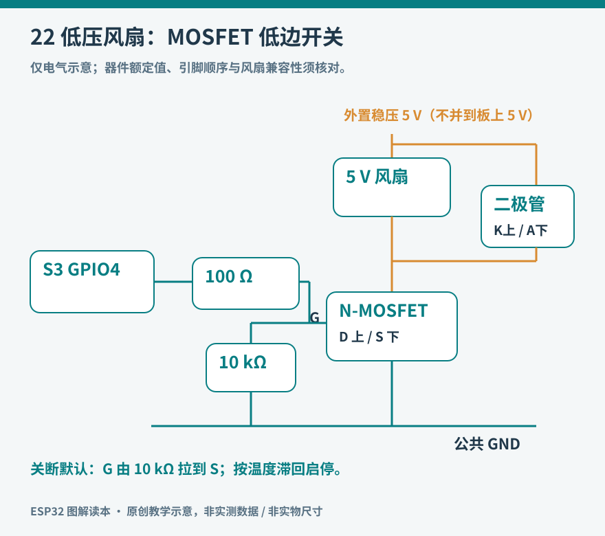

# 第 22 章 项目二：低压风扇控制器

温度越过阈值时打开风扇，降下来以后关闭，看似只有一个判断，却能串起传感器、状态机、功率开关和故障处理。本项目做一个桌面演示装置：ESP32 读取环境温度，通过 MOSFET 控制一只 5 V 小风扇。它用于学习控制过程，不承担设备关键散热或其他安全功能。

这里先使用开、关两种状态，不对普通二线无刷风扇的供电端施加任意 PWM。无刷风扇内部自带换相电路，能否通过供电调速取决于型号；四线风扇则有独立控制输入。需要连续调速时，应采用有明确接口规格的风扇和匹配电路。厂商的四线风扇微控制器指南可以作为下一步对照。[资料：Noctua，Microcontroller guide](https://www.noctua.at/en/support/faqs/microcontroller-guide-pwm-setup-and-rpm-monitoring)



图 22-1：功率回路与控制回路分开；MOSFET 的 G、D、S 表示电极名称，不表示实物封装引脚顺序。滞回规则见本章第二阶段。

## 先把功率回路搭正确

材料包括第 21 章的主板与 BME280、5 V 二线小风扇、独立稳压 5 V 电源、支持 3.3 V 栅极驱动的 N 沟道 MOSFET 转接板、100 Ω 电阻、10 kΩ 电阻，以及符合负载瞬态要求的反向保护二极管。选择工作电流较小、有启动电流资料的风扇，电源和开关按启动电流留余量。

MOSFET 不能只看栅极阈值电压。阈值表示器件刚开始导通的条件，不表示此时足以承载风扇电流。应查看低栅极电压下的导通电阻及散热条件。例如 AO3400A 的原厂资料列出 2.5 V 栅极驱动时的导通电阻指标，可作为小电流开关的候选；实际购买的转接板仍需确认真正确切型号与引脚。[资料：AOS，AO3400A](https://www.aosmd.com/products/mosfets/low-voltage-mosfets-12v-30v/ao3400a)

| 连接 | 接到哪里 | 原因 |
| --- | --- | --- |
| 风扇正端 | 独立 5 V 电源正端 | 风扇电流不流过 GPIO |
| 风扇负端 | MOSFET 漏极 D | 由低边开关控制回流 |
| MOSFET 源极 S | 风扇电源负端与 ESP32 GND | 建立共同参考电位 |
| GPIO4 | 经 100 Ω 电阻接栅极 G | 提供控制信号 |
| 栅极 G | 经 10 kΩ 电阻接源极 S | 上电、复位时保持关断 |
| 保护二极管 | 阴极接风扇正端，阳极接负端 | 正常供电时反偏 |
| BME280 | 仍按第 21 章连接 GPIO8/9 | 温度输入 |

ESP32 用 USB 供电，风扇用独立 5 V 电源。这里只连接两者的地，不把两个 5 V 输出直接并联。断电后用万用表核对共地与 D/G/S 顺序；不同 MOSFET 封装的引脚位置不同，转接板丝印也可能仅标 IN/OUT，不能根据外观猜测。

对感性负载，关断时需要处理储存的能量；低边驱动器的应用资料展示了这类保护思路。[资料：TI，TPL7407LA-Q1 数据手册，Application Information](https://www.ti.com/lit/gpn/TPL7407LA-Q1) 本项目的外置反并联二极管用于限制关断时的反向端电压；无刷风扇含内部电子电路，仍要遵循该风扇的保护要求。二极管不是允许任意快速开关的证明。可在风扇供电端增加合适的去耦电容，但先检查电源和回路，不依靠堆电容掩盖接线问题。

## 第一阶段：先不用温度控制

把风扇固定，保持叶片周围无松散线缆。先只运行每隔数秒开、关一次的 GPIO 测试，观察风扇是否能从静止可靠启动。成功标准是开时持续转动、关时停止，主板不复位，MOSFET 和连接器没有异常升温。

若风扇始终转动，优先断电检查 D/S 接反、栅极悬空或开关损坏。若只有轻推后才转，检查供电电压、启动电流和接触电阻，不把“已经能转”当作成功。也不要通过不断缩短开关周期去猜 PWM 参数。此阶段只验证功率通路，不同时调试传感器。

## 第二阶段：用滞回避免临界抖动

假设设置 30 °C 开启、28 °C 关闭。风扇关闭时，只有温度达到 30 °C 才开启；风扇开启后，只有温度降到 28 °C 才关闭。在 28–30 °C 之间保持原状态。这两个阈值构成滞回，可以避免读数在 30 °C 附近细小变化时不断开关。

下列草图把控制周期设为两秒；阈值仅用于演示，可根据室温临时调整，不要用热风枪、明火或水直接刺激传感器。依赖 Adafruit BME280 Library，适用本章 S3 接线，未进行实物验证。

```cpp
#include <Arduino.h>
#include <Wire.h>
#include <Adafruit_BME280.h>
#include <math.h>

constexpr int FAN_PIN = 4;
Adafruit_BME280 sensor;
bool sensorReady = false;
uint8_t sensorAddress = 0x76;

bool sensorResponds() {
  Wire.beginTransmission(sensorAddress);
  Wire.write(0xD0);  // BME280 chip-ID register
  if (Wire.endTransmission(false) != 0) return false;
  if (Wire.requestFrom(sensorAddress, (uint8_t)1) != 1) return false;
  return Wire.read() == 0x60;
}
bool fanOn = false;
uint32_t lastCheck = 0;

void setup() {
  digitalWrite(FAN_PIN, LOW);
  pinMode(FAN_PIN, OUTPUT);
  Serial.begin(115200);
  Wire.begin(8, 9);
  sensorReady = sensor.begin(0x76, &Wire);
  if (!sensorReady) {
    sensorAddress = 0x77;
    sensorReady = sensor.begin(sensorAddress, &Wire);
  }
}

void loop() {
  uint32_t now = millis();
  if ((uint32_t)(now - lastCheck) < 2000) return;
  lastCheck = now;
  float t = sensorReady && sensorResponds()
            ? sensor.readTemperature() : NAN;
  bool valid = isfinite(t) && t >= -40 && t <= 85;
  if (!valid) fanOn = true;
  else if (!fanOn && t >= 30.0f) fanOn = true;
  else if (fanOn && t <= 28.0f) fanOn = false;
  digitalWrite(FAN_PIN, fanOn ? HIGH : LOW);
  Serial.printf("temp=%.2f valid=%d fan=%d\n", t, valid, fanOn);
  delay(1);
}
```

采样前先检查芯片ID应答，随后检查温度量程；若模块已断开，检查失败就进入本例的故障策略。这仍不是对每个底层事务的完整诊断，也无法检测所有读数偏差。

本例在检测到传感器故障时让风扇开启，并在日志标记无效；初始化失败需排查后重启。这个选择只适合本演示，不能推导成所有机器的安全状态。复位时硬件下拉使风扇关闭，而程序检测到故障后才开启，两者之间存在启动间隔。要求故障期间仍持续散热的系统，需要独立硬件保护与更完整设计。

## 第三阶段：验证控制过程

先把开启和关闭阈值改到当前室温附近，使一次缓慢环境变化可以越过两个边界。记录温度、有效标志和风扇状态，观察中间区间是否保持原状态。不要只听风扇声音判断逻辑，因为转子有惯性，关断后仍会继续转一会儿。

再断电拔掉传感器，重新启动。日志应显示无效，风扇按预定故障策略开启；恢复接线并重启后应回到正常测量。模拟故障要使用断电重接线，不在运行时随意短接供电或信号。

二线风扇没有转速反馈，程序输出“开启”只证明发出了命令，并不证明叶片在转。若要确认执行结果，可增加带转速输出的风扇、转速计或其他反馈，再讨论堵转检测。控制系统由测量、决策和执行构成；给执行部分增加反馈后，才进一步知道命令是否真的改变了现实。

本章完整草图：[examples/fan_controller/fan_controller.ino](../examples/fan_controller/fan_controller.ino)。依赖与接线按本章说明，尚未完成编译及实板验证。
