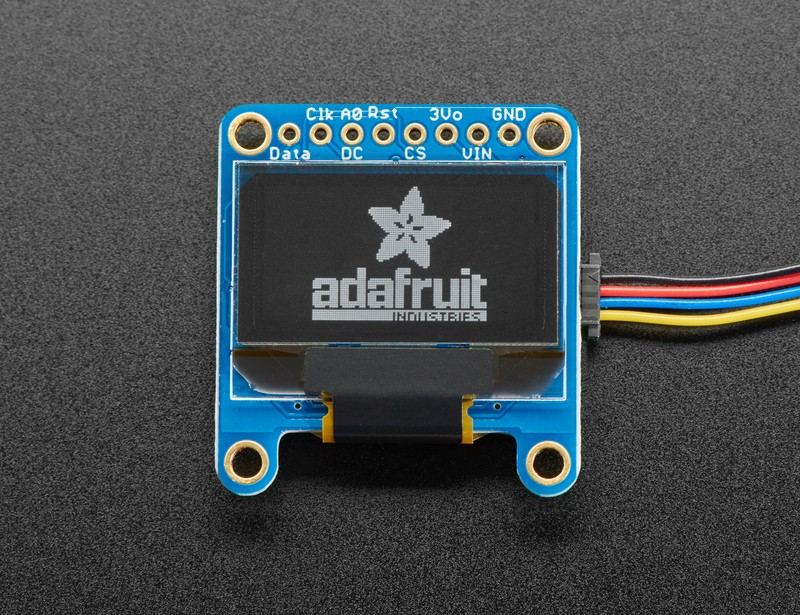
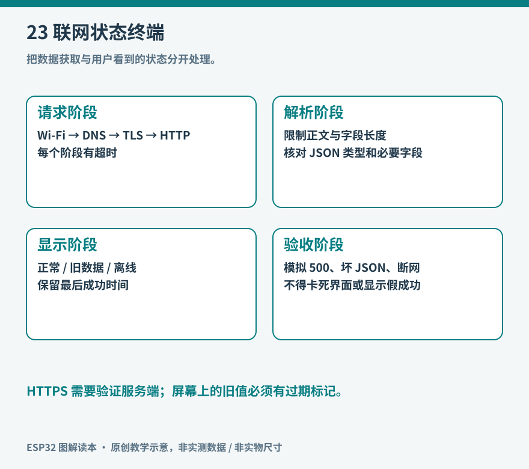

# 第 23 章 项目三：联网状态终端

状态终端把另一台设备或服务的状态放到桌面小屏上。它可以显示家中服务器是否可达、任务是否完成，或者空气记录器是否持续上报。与单纯显示网络数据相比，这类设备更重要的工作是区分“服务报告异常”“终端拿不到数据”和“仍显示上一次成功结果”。

本项目先从本地 HTTP 接口读取一小段 JSON，用 OLED 显示状态和数据年龄。接口由电脑提供，不依赖第三方账号或在线服务。完成后再把接口替换为实际系统，HTTPS、认证和权限控制按第 19 章补齐。



*实物参照：这张旧版多接口 OLED 供外观识别；本章程序要求已经配置为 I2C、分辨率为 128×64 的 SSD1306 模块。 图片：Kattni Rembor / Adafruit，[来源](https://learn.adafruit.com/assets/93886)，[CC BY-SA 3.0](https://creativecommons.org/licenses/by-sa/3.0/)；仅调整尺寸与文件格式。*

把屏幕上的黑色矩形、转接板和接口分开辨认。收到模块后先核对控制器和接口模式，再执行下文四线连接表；图中额外的 CLK/DC/CS 等孔位不能按外观猜接。最终终端的 `NO DATA`、`STALE` 等显示由本章程序产生，来源照片中的厂商品牌图案不是本项目运行截图。




图 23-1：每一层成功都有独立含义。Wi-Fi 已连接不代表服务正常，HTTP 200 也不代表内容符合约定。

## 材料与接口约定

材料为 ESP32-S3-DevKitC-1、一块支持 3.3 V 供电和逻辑的 SSD1306 128×64 I2C OLED、USB 数据线和短跳线。OLED 的 VCC 接 3V3，GND 接 GND，SDA 接 GPIO8，SCL 接 GPIO9。先核对模块接口顺序、控制器型号和上拉电压；外观相似的 SH1106 屏不能直接假定使用同一驱动。

在库管理器安装 Adafruit SSD1306、Adafruit GFX 及依赖；先运行厂商示例，确认图案正常，再整合网络部分。OLED 初始化需要与实际尺寸和 I2C 地址匹配，本章示例使用 0x3C，若模块为其他地址应据实修改。[资料：Adafruit，Monochrome OLED Arduino Library & Examples](https://learn.adafruit.com/monochrome-oled-breakouts/arduino-library-and-examples)

本项目约定接口成功时返回以下内容：

```json
{"state":"ok","revision":1}
```

`state` 允许 `ok`、`degraded`、`maintenance` 三种值；`revision` 用来观察接口内容是否被更新。本地测试文件只演示通信和界面，不会自动检测任何真实服务。若以后显示服务器健康状态，应明确由谁、通过什么检查生成字段，而不是把“下载到一个静态文件”当作服务器内部正常的证据。

在电脑上新建一个只放测试文件的目录，把上述内容保存为 `status.json`。切换到该目录，运行 Python 自带的测试服务器：

```bash
python3 -m http.server 8000 --bind 192.168.1.50
```

将地址替换为电脑在同一局域网中的实际地址。不要在包含个人文件的目录启动服务。先用另一台设备访问 `http://电脑地址:8000/status.json`；如果打不开，检查绑定地址、防火墙和无线客户端隔离。ESP32 访问的地址不能写 `127.0.0.1`，那会指向 ESP32 自己。该服务器只用于受控局域网实验，结束后按 Ctrl+C 停止，不做公网端口映射。

## 让显示与网络失败分开

定义三个时间：上次发起请求、上次拿到有效数据、现在。屏幕显示的数据年龄是“现在减去上次有效数据时间”。HTTP 失败、JSON 错误或字段不认识时，都不刷新这个时间，因此旧值会逐渐变陈旧。

可采用五秒请求一次、十五秒无有效数据便标为 `STALE` 的教学参数。这些是本项目的界面策略，不是网络协议标准。实际设备按业务节奏设置：五分钟更新一次的气象数据不应十五秒就报警；控制指令的有效期又可能比状态显示短得多。

以下是联网读取与显示的主流程伪代码，目的是明确各层责任，不是可直接烧录的草图：

```text
启动：初始化屏幕，显示 CONNECTING，启动 Wi-Fi 连接
循环：
  如果距上次请求超过 5 秒且已有 Wi-Fi 连接：
    发起有超时的 HTTP GET
    若状态码为 200 且响应体未超过限制：
      解析 JSON
      检查 state 属于允许集合，revision 是非负整数
      若均通过：替换 lastGood，记录 lastGoodTime
    无论成功失败：关闭请求资源，记录错误类别
  每秒更新一次显示：
    尚无有效数据 → NO DATA
    有有效数据 → 显示状态与 age
    age 超过 15 秒 → 明确标记 STALE
```

HTTP 请求超时不宜大于正常刷新间隔许多倍；同步调用期间，屏幕按钮可能暂时不能响应。第一版可以接受短暂等待，但要测量它。如果需要流畅交互，把网络请求放到独立任务，再用队列传递完整结果，避免两个任务同时修改屏幕缓冲区。

## 把 JSON 转成受约束的数据

安装 ArduinoJson 7。以下片段展示解析后的检查，应放在获取到有长度限制的响应体之后。它没有包含 Wi-Fi、HTTP 或显示初始化，不能单独烧录。

```cpp
#include <ArduinoJson.h>

JsonDocument doc;
DeserializationError err = deserializeJson(doc, body);
bool accepted = !err && doc["state"].is<const char*>()
                && doc["revision"].is<unsigned long>();
String nextState;
unsigned long nextRevision = 0;
if (accepted) {
  nextState = doc["state"].as<const char*>();
  accepted = nextState == "ok" || nextState == "degraded"
             || nextState == "maintenance";
  nextRevision = doc["revision"].as<unsigned long>();
}
```

解析成功只证明文本具有合法 JSON 结构，不能代替字段类型和取值验证。更改屏幕数据之前，先把全部字段检查完，再一起提交，避免出现“新状态配旧版本号”的半更新。错误页面可能是合法 HTML，也可能是结构不同的合法 JSON，均应作为接口错误处理。[资料：ArduinoJson，v7 Deserialization tutorial](https://arduinojson.org/v7/tutorial/deserialization/)

本项目可将响应体上限设为 512 字节，状态码不对就不解析。实际实现应限制真实接收字节数，而不能只相信服务器给出的 `Content-Length`；未知长度和分块传输也要有边界。Arduino HTTPClient 与 JSON 流读取结合时还需了解传输编码处理，不能把 TCP 原始字节流直接当成剥离过 HTTP 的 JSON。[资料：ArduinoJson，HTTPClient 集成说明](https://arduinojson.org/v6/how-to/use-arduinojson-with-httpclient/) 该集成页展示旧版库语法，本文字段解析采用上面的 v7 写法，不混用文档版本。

## 屏幕只回答读者需要判断的事

128×64 屏幕无需装满网络细节。可以安排三行：`SERVICE OK`、`rev 1`、`age 3s`。没有有效数据时显示 `NO DATA`；旧数据则显示 `STALE` 和上次状态。Wi-Fi 图标只能说明接入情况，不能取代服务状态。

使用默认小字库时，先用 ASCII 显示，避免中文字体资源和编码问题掩盖通信调试。数据不变化时不必整屏持续刷新；对 OLED 而言，长时间固定显示也应考虑屏幕寿命与适度息屏。按钮的手动刷新应有频率限制，不能每次循环都发送网络请求。

## 按四种故障验收

| 实验 | 操作 | 期望结果 |
| --- | --- | --- |
| 内容变化 | 将 state 改为 degraded，revision 加一 | 下一次成功请求后整体更新 |
| 接口停止 | 停止电脑测试服务器 | 保留旧值，年龄增加，随后标记 STALE |
| 内容无效 | 把 JSON 改成不完整文本或未知 state | 标记解析或字段错误，不刷新有效时间 |
| 无线中断 | 暂时关闭路由器后恢复 | 显示失联，恢复后重新获得有效数据 |

每项实验保存一段串口日志，至少包括时间、HTTP 状态或错误类别、是否接受新数据。不要把网络密码和完整认证令牌写入日志。四项都通过后，再更换真实数据源；替换时保持相同的接口约定和验收方法，便能把服务自身的问题与终端显示问题分开。

这个项目的成果不是一个永远亮着绿色灯的小屏，而是一台能诚实表达信息新旧、知道自己何时失去依据的终端。这种设计同样适用于仪表盘、智能家居面板和远程任务提示器。

完整草图：[examples/network_terminal/network_terminal.ino](../examples/network_terminal/network_terminal.ino)。使用前填写自己的局域网地址和无线配置；代码对真实响应体限长，保留最后有效数据并标记陈旧状态。该例使用仅限本地实验的明文 HTTP，不传输令牌；它尚未经过编译与实板验证。完整例程用 64 位单调计时器累计有效数据年龄，避免以 32 位毫秒数长期记录时的回绕歧义；上电后时间仍从头开始。同步请求期间界面可能短暂等待，长期运行还应完善重连策略。
