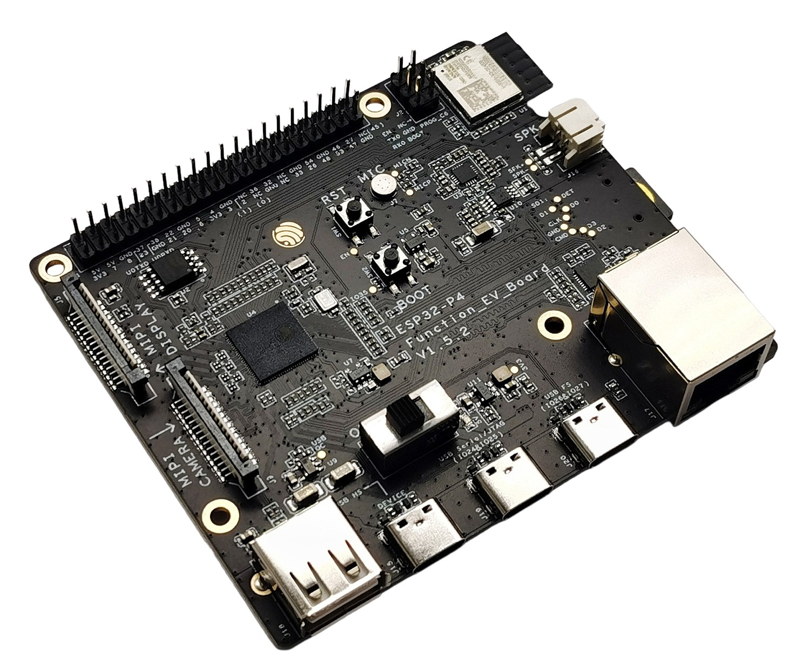
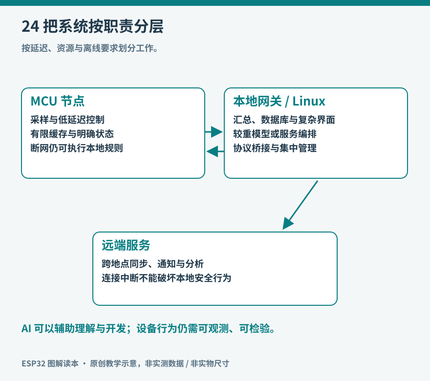

# 第 24 章 从 ESP32 走向完整系统

一块 ESP32 能完成测量、控制、通信和简单界面，多个节点又能组成更大的系统。但扩大系统不等于不断给单个芯片增加任务。更有用的做法，是把职责放到适合的位置：传感器附近负责及时采集和基本动作，网关负责跨协议连接与本地管理，服务器负责长期数据、复杂计算和多用户应用。

本书以 ESP32 为入口，最终希望建立的判断能力，是看见功能背后的资源、接口和故障边界。下一次面对“做一个智能设备”的想法时，可以先把它拆成可验证的几部分，再决定硬件与软件。

*实物参照：面向更多外设功能的 P4 评估板。较多连接器让人直观看到多媒体与接口需求怎样改变开发板形态。 图片：Espressif Systems，[来源](https://docs.espressif.com/projects/esp-dev-kits/en/latest/esp32p4/esp32-p4-function-ev-board/user_guide.html)，[CC BY-SA 4.0](https://creativecommons.org/licenses/by-sa/4.0/)；仅调整尺寸与文件格式。*

这块评估板同时配置了额外的无线连接器件；板上有无线能力，不等于 P4 芯片本身内置无线电。看系统资料时，应把主处理芯片、无线协处理器、以太网/USB 等接口分别追踪。本书不将这块板作为 S3 实验的直接替代品。

图 24-1：功能沿着数据与控制的路径分布。外部连接中断时，设备仍应保留约定的本地行为。

## 哪些工作留在 MCU，哪些交给 Linux

MCU，即微控制器，适合直接连接引脚、定时采样、运行状态机，并在有限资源内持续工作。Linux 单板计算机通常拥有更丰富的内存、文件系统、进程隔离和应用生态，适合数据库、复杂网页、媒体处理和多个服务。两者可以合作，也可以分别独立使用；“更强的处理器”并不自动得到更合适的系统。

以温室监测为例，节点每分钟读取温湿度，本地保存最近记录；网关收集多个节点的数据并提供局域网界面；服务器绘制长时间曲线。若要控制执行器，节点应在通信丢失时进入明确的本地策略，而不是把是否行动完全依赖于下一次网络回复。具体策略取决于对象，不能从桌面风扇实验直接搬到灌溉或加热设备。

| 需求 | 优先考虑的职责位置 | 需要额外检查的条件 |
| --- | --- | --- |
| 按钮、灯光、简单传感器 | MCU 本地 | 引脚与电气兼容、响应时间 |
| 多种家居协议的汇聚 | 网关 | 无线硬件、协议支持与恢复 |
| 长期历史记录与查询 | 网关或服务器 | 存储寿命、备份、时间一致性 |
| 大模型推理或复杂媒体处理 | 能力匹配的主机或服务 | 延迟、隐私、费用与离线策略 |
| 设备现场保护 | 独立本地设计 | 故障模式与硬件约束 |

当 Linux 主机需要无线能力时，ESP32 也可作为协处理器。ESP-Hosted 是一个真实例子：通过有线总线连接主机与 Espressif 无线芯片，分担连接功能。具体芯片、总线、驱动和协议支持需要按该方案当前文档核对，不是任意两块板接上 SPI 就能直接获得无线网卡。[资料：Espressif，ESP-Hosted](https://github.com/espressif/esp-hosted)

## 使用现成生态，仍要理解底层约束

不是每个环境传感器都值得从头编写固件。ESPHome 以配置描述设备和组件，适合把常见传感器、开关、显示等接入智能家居。它减少重复代码，但仍需要正确的板型、引脚、地址和电源连接；总线接反不会因为配置更短而自行修复。[资料：ESPHome，ESP32 Platform](https://esphome.io/components/esp32/)

例如本书的 BME280 已有对应组件，可以声明 I2C 总线和温湿度气压实体，再设置更新间隔。采用配置方案后，应保留配置版本与固件构建信息，同样验证断网、传感器失联和重新上电。组件是否存在、支持哪种框架以及参数名称都随项目版本演进，应参考当前文档，而非永久保存一份未经标注版本的网上 YAML。[资料：ESPHome，BME280 组件](https://esphome.io/components/sensor/bme280/)

从本书的 Arduino 项目转向 ESPHome，收获是复用成熟集成；转向 ESP-IDF，收获是更直接控制底层资源与系统配置。这两条路线没有统一的高低顺序。项目需要快速接入现有家居系统时，配置方案常更直接；需要特殊协议、严格资源分配或深入调试时，完整固件工程更合适。

## 屏幕、声音与摄像头为什么更占资源

环境数据每次只有几个数，而图像和声音需要持续搬运大量数据。128×64 单色画面仅像素缓冲就约 1 KiB；320×240、16 位颜色的一帧则约 150 KiB。分辨率、颜色深度、帧率和缓冲数量相乘，很快就会超过直觉中的“只加一个屏幕”。压缩能够减少存储或传输量，却又引入解码成本和延迟。

因此要先做预算，再选接口。屏幕需要确认控制器与刷新方式，音频需要确认采样率、位深和输入输出电路，摄像头需要确认像素格式、缓存和数据通路。PSRAM 可以增加容量，但并不等于所有访问都与片内 SRAM 同样快；同时处理摄像头、界面和网络时，任务调度与内存带宽也成为限制。

现成开发平台可以帮助观察完整系统如何组织。ESP-BOX 系列公开了软硬件与示例，将显示、音频和交互组合在一起；阅读它的板级支持代码和模块划分，比只复制一段“录音函数”更能看到各部分的依赖。具体产品的销售与维护状态应以项目说明为准。[资料：Espressif，ESP-BOX](https://github.com/espressif/esp-box)

## 边缘 AI 的实际含义

设备端运行小模型，可以用于唤醒词、声音事件分类、简单视觉识别或传感器异常检测。这里的“运行模型”主要指推理：把输入经过预处理后送入模型，得到类别、分数或其他结果。训练通常在资源更充足的环境完成，再进行适合目标芯片的转换、量化和部署。

ESP-DL 提供面向 Espressif 芯片的模型加载与推理能力，模型能否部署要检查支持算子、内存、精度与实际延迟，而不是只比较模型文件大小。[资料：Espressif，ESP-DL Introduction](https://docs.espressif.com/projects/esp-dl/en/latest/introduction/readme.html) 语音领域还有 ESP-SR 等工具链，需要按具体芯片和功能选择对应文档。[资料：Espressif，ESP-SR S3 用户指南](https://docs.espressif.com/projects/esp-sr/en/latest/esp32s3/index.html)

一个合理的入门实验，是先用普通阈值完成声音触发，再与小模型结果比较，记录安静、风扇运行、说话和敲击等条件下的误报与漏报。若模型只在演示者面前表现良好，换个房间就失效，就需要重新检查数据与测试条件。AI 不会免除测量误差、部署偏差和电源问题。

ESP32 也可以录制声音、上传图像或显示远端模型回复，但这与在 ESP32 上本地运行那个大模型是两件不同的事。描述系统时，应明确哪些步骤发生在板上、网关或云端，以及断网后哪些功能保留。这样才能正确评估延迟、隐私、成本和可用性。

## 为下一项目写一页说明

挑选一个足够小的目标，例如“书桌显示最近一次备份是否成功”，写下输入来源、输出形式、刷新节奏、供电方式、可接受延迟和失联后的表现。再列出成功证据：接口能返回固定数据、屏幕能显示、旧数据会标记、断电重启能恢复。先用固定数据跑通，再接真实接口，最后整理外壳和供电。

这页说明应同时写明不支持的环境与功能，例如仅限室内、USB 供电、不控制关键设备。边界使测试范围具体，也能避免一个兴趣项目在不断增加功能后失去可验证的目标。完成一台能解释、能复现、能恢复的小设备，比把许多组件名称堆在同一块板上更接近完整系统。
